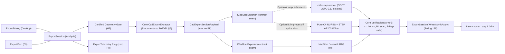

# Architecture: Area 7 CAD Export Kernel (STEP AP203 & Rhino 3DM)

- **Status:** Proposed (2026-11-19). Docs-only architecture brief; zero `src/`, `tests/`, or `DESIGN.md` edits.
- **Tier:** T2 (cross-platform native ABI, licensing boundary `COMMIT-02`, physical CAM/manufacturing interchange `EXP-02`).
- **Driving spec:** [CFD-Workbench Product Specification v1.7.6](../specs/cfd-workbench-v1.md) (A2, A4.11, A4.12, A5.6, A6 `EXP-01`–`EXP-05`, `LAB-01`, A8.1, A8.5).
- **Companion ADR:** [ADR-0013: Area 7 CAD export kernel](../adr/0013-cad-export-kernel.md) (proposed).
- **Author / Track:** `w5-kernel-arch` (Wave 5 Track `KRN`). Independent Adversary review by `w5-verifier` (Enterprise Architect, Computational Geometry, Security) and operator ruling are required before acceptance.

Confidence labels used throughout this document:
- **[Verified]** — directly observed in repository source, committed specifications, rulings, or executed spike receipts.
- **[Inferred]** — reasoned from Verified evidence; carries the basis of inference.
- **[Flagged]** — unverified external packaging/ABI state, recalled standard details, or unexecuted runtime behavior; must be closed by `SPIKE-CAD-01` or `SPIKE-CAD-02` before any implementation starts.

---

## 1. Context, Verified Baseline, and Surfaced Drifts

### 1.1 Graph Grounding Path

Grounding traversed: `spec-cfd-workbench-v1 → adr-application-stack → architecture-application`, `spec-cfd-workbench-v1 → spec-foildsl → adr-0010-one-placement-rule`, `spec-cfd-workbench-v1 → design-export → StlExport.cs / ThreeMfExport.cs / ExportSession.cs / ExportDialog.axaml.cs / ExportVerb.cs`, `spec-cfd-workbench-v1 → kernel-spike-occt-loft → kb-hw-file-formats-and-grammars / kb-hw-parametric-curves-lofts-and-surfaces`, and `architecture-application → threat-model / adr-0012-openfoam-backend-macos → rulings`.

### 1.2 Hard Constraints (Exact Spec & Code Baseline)

| Constraint | Source | Exact Requirement | Confidence |
|---|---|---|---|
| **COMMIT-02 (Licensing)** | `docs/specs/cfd-workbench-v1.md:211-212`, A8.5 `:1379-1383` | "permissive licences (MIT, BSD, Apache) may be linked; GPL, LGPL, AGPL and NOSA components are process-invoked or excluded; the licence register (A8.5) is a release artefact." A8.5 explicitly lists `OCCT (LGPL)` under **Process-only or excluded** and `rhino3dm` under **Linked: MIT/BSD/Apache only**. | [Verified] |
| **Application Stack** | `docs/adr/0003-application-stack.md:33-37,49`, Ruling 239 | Native modular monolith in C#/.NET 10 (`global.json` pins `10.0.402`, `rollForward: latestPatch`) and Avalonia `11.3.14`. Export geometry kernel explicitly unselected. | [Verified] |
| **Target Platforms** | Ruling 238 (`rulings.md:1825-1827`), Ruling 70 OQ-5 (`cfd-workbench-v1.md:1090`), `AGENTS.md` | **Windows ARM64** (active Windows platform of record), **Windows x64** (planned rerun and CI runner), **macOS ARM64** (CI runner and compiled target; Intel Mac unsupported). **Offline-first:** zero cloud or network dependency (`A8.1 Privacy`). | [Verified] |
| **One Placement Authority** | `docs/adr/0010-one-placement-rule.md:63-88`, `src/CfdWorkbench.Core/Placement.cs:54-115,295-333` | FoilDSL §6 Rule A (`X = L + c(x cos φ + z sin φ)`, `Y = h·η`, `Z = D + c(−x sin φ + z cos φ)`) exists once in `Placement.cs`. `Placement.Surface` / `Placement.Frame` / `Placement.Sections` / `Placement.OwnProfile` / `Placement.ChordGrid` are the sole binary64 geometry readers, bound to the rational-interval certificate within **1 nm**. Symmetry map is `Point3.Port()` (`(x, y, z) → (x, −y, z)`). | [Verified] |
| **EXP-02 & EXP-05 (STEP AP203 & Fusion)** | `docs/specs/cfd-workbench-v1.md:189,641-642,1231,1286,2315,2333` | STEP AP203 writes `B_SPLINE_SURFACE_WITH_KNOTS` (non-rational proven) inside faces and a shell, in **millimetres, unscaled**, with declared uncertainty and measured A-vs-B skin deviation (`≤ 10 µm` at local chord, A4.12). Two variants: **Fusion-ready STEP (closed shell)** (`MANIFOLD_SOLID_BREP`) and **untrimmed surfaces** (`OPEN_SHELL`). Native `.f3d` is a non-goal. **Release gate:** unavailable (`"STEP export unavailable until the open-and-measure fixture exists"`, COPY-481) until open-and-measure in **two named CAM systems and in Fusion** passes with quantities stored as a fixture. | [Verified] |
| **EXP-04 (Rhino 3DM)** | `docs/specs/cfd-workbench-v1.md:643,1285` | Writes loft skin as NURBS surfaces, plus the five master channels as NURBS curves and authored station profiles as curves on their planes, in **millimetres, unscaled**, with ubiquitous-language layer names. Reports chord at three stations and maximum skin deviation (`≤ 10⁻¹²` relative on exact paths, `≤ 10 µm` model/join otherwise). **Release gate:** Rhino open-and-measure fixture stored. | [Verified] |
| **Export Slice A As-Built Contract** | `docs/design/export.md`, `StlExport.cs`, `ThreeMfExport.cs`, `ExportSession.cs`, `ExportCopy.cs`, `ExportDialog.axaml.cs`, `ExportVerb.cs`, Rulings 193–198 & 203–204 | `.dat`, binary STL, and 3MF already ship in-process with zero CAD kernel. `ExportSession` enforces: accepted `GeometryStatus.Certified` revision only (never an open draft); always-on TE row (`Least thickness ... Floor 0.30 mm (app default, no source)` + `Manufacturing: not assessed (no process chosen)`); below-floor advisory never blocks; fixed A5.6 safety string on every geometric format; forced extension; refusal of symlink targets (`EXPORT-TARGET-LINK`), folders (`EXPORT-TARGET-DIRECTORY`), and unconfirmed forced-extension collisions (`EXPORT-WOULD-REPLACE`); atomic temp-then-rename (`WriteAtomicAsync`, `.cfd-<guid>.tmp`); zero-PII session telemetry (`export.write`, `export.validate`); shared GUI (`ExportDialog`) and CLI (`ExportVerb`) execution. | [Verified] |
| **LAB-01 (Forbidden Claims)** | `docs/specs/cfd-workbench-v1.md:206-207,1229` | No product copy or export metadata may contain `"cavitation-free"`, `"ventilation-safe"`, `"validated"` (outside ITTC), `"optimized"`, `"best"`, `"recommended"`, or `"certified"` without an A7 grant. Export deviation is explicitly labelled **sampled, not a bound**, and not a certificate. | [Verified] |
| **Zero-PII Export Metadata** | Ruling 196 A6 (`cfd-workbench-v1.md:1232`), `ThreeMfExport.cs:27-28,99-114`, `tools/check-proof-pii.py` | Export files must never embed the OS user name, local file path, or machine hostname. `ThreeMfExport` fixes ZIP timestamps to `1980-01-01T00:00:00Z` for byte reproducibility and restricts metadata to `Title`, `Description`, and `Application`. | [Verified] |
| **Mathematical Non-Polynomial Nature of Rule A** | `kb-hw-parametric-curves-lofts-and-surfaces` §5, `Placement.cs:90-115` | Because Rule A applies `cos(twist(η))` / `sin(twist(η))` rotation and per-η thickness renormalization `T0 / max_x T0`, the exact wing surface is **not** a polynomial tensor-product B-spline in span `η`. Every STEP/3DM NURBS surface is therefore a **derived approximation** whose A-vs-B closest-point deviation against `Placement.Surface` must be measured and reported on every write. | [Verified] |

### 1.3 Surfaced Spec and Evidence Drifts

Three material drifts exist between older spec 1.3 text and later rulings. This architecture surfaces them explicitly rather than contradicting them silently:

1. **Drift 1 — `COMMIT-02` & A8.5 vs Spec 1.3 A4.12 (LGPL linking):**
   - `COMMIT-02` (`cfd-workbench-v1.md:211-212`) and A8.5 (`:1382-1383`) require LGPL components—explicitly naming `OCCT (LGPL)`—to be **process-invoked or excluded**.
   - Spec 1.3 A4.12 (`:655-656, 672-674`) proposed calling OCCT "via P/Invoke from C#" by relying on the OCCT LGPL-2.1 exception.
   - **Architectural resolution:** Process-isolating any OCCT dependency (Option A / Option C) or eliminating OCCT with a pure-C# STEP writer (Option B) satisfies `COMMIT-02` and A8.5 strictly without requesting an exception, while also isolating native C++ crashes/OOM from the Avalonia process. `DR-KRN-5` tracks reconciling A4.12's P/Invoke sentence.
2. **Drift 2 — Spec 1.3 Zero-Chord Tip vs Spec 1.7.3/1.7.4 Finite Planar Tip (Rulings 92, 93, 95):**
   - The 2026-09-21 OCCT loft spike (`docs/notes/kernel-spike-occt-loft.md`) met the `≤ 10 µm` target at `N = 16` uniform sections for regular wings (`1.1 µm` base, `0.5 µm` `+6°` twist), and failed only on a **zero-chord tip** (`2.5–18 mm`).
   - Spec 1.7.3 (Ruling 92) and 1.7.4 (Rulings 93, 95) (`cfd-workbench-v1.md:819, 823-830`) subsequently defined the v1 tip of record as an **open planar end at the last authored station** with finite tip chord `c_tip ≥ max(5 mm, 2% c_root)`. `Geometry.cs:337-339` assesses only `Tip == "open"`.
   - **Architectural consequence:** Zero-chord tip singularities are out of scope for v1. However, the spike's core lesson **still governs**: loft sections MUST be placed at **every rail knot position and every authored station**, then refined until A-vs-B deviation passes `≤ 10 µm`—never uniform-only grids. Legacy files with very small finite tips (`< 5 mm`) remain covered by the live A-vs-B deviation check (fail closed if `> 10 µm` or report honestly).
3. **Drift 3 — Spec 1.3 Platform Matrix vs Ruling 238:**
   - `kernel-spike-occt-loft.md` executed only on **macOS ARM64** (FreeCAD 1.1.1 / OCCT 7.8.1 Python) and named Windows x64 as remaining.
   - Ruling 238 (`rulings.md:1825-1827`) established **Windows ARM64** as the active Windows platform of record, with Windows x64 as a planned follow-up. Native `win-arm64` binary availability for both `Rhino3dm` and OCCT is **unverified ([Flagged])** and becomes the primary gate of `SPIKE-CAD-01`.

---

## 2. Systems View, LOA Archetype, and Domain Data Model

### 2.1 Systems View (Meadows)

- **Stocks:** Accepted immutable `Surface revision` bytes (FoilDSL 4.0/4.1 + pinned profiles); transient per-export scratch directory (input curve payload + candidate output bytes, deleted on exit); session telemetry ring (`256` events, zero PII); committed open-and-measure fixture receipts (`docs/proof/cad-export-measure/`).
- **Flows:** Accepted FoilDSL source → `Placement` evaluation & compatible section B-spline extraction → NURBS loft/skinning → B-Rep face/shell assembly (tips, TE strip, root cap/mirror) → A-vs-B closest-point deviation verification → PII header check → atomic temp-then-rename publication (`ExportSession.WriteAtomicAsync`) → `export.write` / `export.validate` telemetry.
- **Feedback loops:** Adaptive spanwise section refinement loop (start at `{rail knots ∪ authored stations}`, double span intervals until `max_dev ≤ 10 µm`, bounded by a strict termination variant `R ≤ 4` refinement rounds / `N ≤ 257` sections; exceeding cap fails closed or surfaces explicit deviation warning, never infinite refinement); UI option-change generation counter (`ExportSession.generation`) cancelling superseded background preparations.
- **Delays:** Background preparation (`PrepareAsync`) off the UI thread with skeleton summary (`H10`), cancellable write/worker timeout (`≤ 30 s`), bounded process-tree kill on cancellation (`≤ 2 s`).
- **Leverage point:** The high-leverage structural decision is **keeping FoilDSL + `Placement.cs` as the single geometry authority and isolating third-party B-Rep/format mechanics behind a narrow, stateless, argv-driven contract**, rather than letting a CAD kernel creep into interactive editing or persistence.

### 2.2 LOA Archetype and Tier Allocation

Area 7 Export has explicitly **"No assistant action here"** (`docs/specs/cfd-workbench-v1.md:1173`). Every export capability is deterministic engineering computation with zero LLM involvement.

- **Selected Archetype:** **Pure-T0 Deterministic Pipeline + Isolated Process Adapter** (specialization of LOA P1 cheapest sufficient tier, P2 determinism at the floor, P3 no cognition on execution paths, P5 verification over plausibility via A-vs-B measurement and read-back topology checks, P8 idempotent/atomic side-effect publication, P11 least-privilege process isolation).
- **Rejected Archetypes:** Every LLM-mediated LOA archetype (Tool-Mediated Constructor, Grounded Synthesizer, Agentic Loop) is rejected for Export because CAD geometry serialization and manufacturing interchange tolerate zero stochasticity.

| Capability | LOA Tier | Justification (P1 / P2) |
|---|---|---|
| Section & channel evaluation (`Placement.cs`, compatible section curves) | **T0** | Deterministic math in `CfdWorkbench.Core`; single placement authority (ADR-0010). |
| NURBS skinning, B-Rep shell sewing, STEP AP203 / 3DM serialization | **T0** | Deterministic geometry/file serialization; zero cognition needed. |
| A-vs-B skin deviation check & byte/header PII verification | **T0** | Mechanical closest-point verification and closed-set header lint (P5). |
| Atomic file publication & telemetry emission | **T0** | Reuses `ExportSession.WriteAtomicAsync` and `ExportTelemetry` ring (P8, P10). |

### 2.3 Domain & Durable Data Model (DM1–DM18)

- **Bounded Context:** **Export** (a read-only consumer of the **Design** bounded context's accepted `Design revision` and `Surface revision`).
- **Durable Project Schema Impact:** **Zero.** STEP and 3DM outputs are one-way derived interchange files, never persisted in `.cfdw.json` and never a second geometry authority (DM7, ADR-0002, ADR-0010). No migration or `.cfdw.json` format version bump is required.
- **Entities, Values, and Facts (grain declared before columns):**

| Object | Kind | Grain ("one record is exactly one…") | History / Mutability | Key Fields & Additive Classification |
|---|---|---|---|---|
| `CadExportRequest` | Value | …export preparation request over one accepted revision | Immutable transient | `SourceHash`, `RevisionOrdinal`, `Format` (`StepClosedShell`, `StepUntrimmed`, `Rhino3dm`), `Scope` (`Whole`, `Half`), `TargetDeviationMm` (`0.010` mm default). Non-additive. |
| `CadExportSectionPayload` | Wire DTO | …normalized wing geometry handoff to a STEP/3DM writer | Immutable transient (deleted after run) | `SchemaVersion` (`1`), `Unit` (`"mm"`), `Scope`, `Variant`, `FoilSlug`, `RevisionOrdinal`, `Sections[]` (ordered `η`, exact `Point3` poles in mm, degree, knots, upper/lower curves, closed/open TE flag), `MasterCurves[]` (5 channels for 3DM), `AuthoredStations[]` (for 3DM). No user paths, usernames, or hostnames. |
| `CadExportResult` | Derived Value | …built and verified CAD export byte payload | Immutable transient | `Bytes`, `Format`, `Scope`, `SectionCount`, `SurfaceDegreeU`, `SurfaceDegreeV`, `MeasuredDeviationMm` (A-vs-B max closest-point, non-additive), `SampleCount`, `ToleranceMet`, `ClosedSolidVerified`, `TrailingEdgeMm`, `TrailingEdgeYMm`, `TrailingEdgeAtTip`, `TrailingEdgeAlongSpan`, `SizeXMm/YMm/ZMm`, `VolumeMm3` (null for untrimmed). |
| `ExportTelemetry` | Append-only Fact | …one `export.write` or `export.validate` event in the 256-row session ring | Append-only (Type-2 immutable fact; in-memory session ring) | Existing schema (`ExportSession.cs:389-392`) extended additively with `Format` values `step-solid`, `step-surfaces`, `3dm`; additive metrics `Milliseconds`, `Bytes`; non-additive `DeviationMm`; `Triangles` null for NURBS. Zero PII. |
| `CadFixtureReceipt` | Append-only Fact (repo) | …one open-and-measure verification run of one exported file in one target CAD/CAM tool | Immutable committed JSON under `docs/proof/cad-export-measure/` | `ToolName`, `ToolVersion`, `OsArch`, `Format`, `Variant`, `Scope`, `WingFixture`, `FileSha256`, `DetectedUnit`, `SpanMm`, `RootChordMm`, `MidChordMm`, `TipChordMm`, `MaxThicknessRootMm`, `TrailingEdgeMm`, `IsWatertightSolid`, `RepairWarningsCount`, `VolumeMm3`, `Pass`. |

*Data & Persistence Architect note:* Because `.cfdw.json` is untouched and exported files are derived artifacts checked against the accepted revision hash, no durable store invariant is weakened. Derive-don't-store (DM7) holds strictly.

---

## 3. Candidate Architecture Evaluation Matrix

Four genuinely distinct architectural shapes were evaluated against `COMMIT-02`, target platforms (`win-arm64`, `win-x64`, `osx-arm64`), `EXP-02`/`EXP-04`/`EXP-05`, ADR-0010, and the existing OCCT loft spike.

### 3.1 Option Summary

- **Option A — Hybrid (Recommended baseline to test in `SPIKE-CAD-01`):**
  - `CfdWorkbench.Core` owns exact Rule A section evaluation, knot-aligned station selection, and A-vs-B deviation verification.
  - **STEP AP203:** Process-isolated C++ CLI worker (`cfdw-step-worker`) linking **OCCT (LGPL-2.1 with OCCT exception)** invoked strictly via argv over a per-run scratch directory. Uses `BRepOffsetAPI_ThruSections`, planar tip/root/TE face construction, `BRepBuilderAPI_Sewing`, `BRepCheck_Analyzer`, and `STEPControl_Writer`.
  - **3DM:** In-process **MIT `rhino3dm`** NuGet (or, if `Rhino3dm` NuGet lacks `win-arm64`, a thin product-built MIT `openNURBS` C++ native library or MIT CLI helper) consuming either Core's compatible B-spline loft or the worker's exact B-spline surface poles/knots so STEP and 3DM agree.
- **Option B — Pure-C# NURBS Skinning + Direct STEP AP203 Writer (+ MIT `rhino3dm`/`openNURBS` or Pure-C# for 3DM) (Co-evaluated in `SPIKE-CAD-01`):**
  - Zero native/LGPL dependencies for STEP! `CfdWorkbench.Core` computes compatible degree-5 section B-splines at `{rail knots ∪ authored stations}` (+ adaptive η refinement), performs global tensor-product B-spline skinning (`u` degree 5, `v` degree 3) in pure C#, checks A-vs-B deviation via Newton surface projection, and emits ISO 10303-21 ASCII STEP AP203 directly (`B_SPLINE_SURFACE_WITH_KNOTS`, planar `PLANE` tip/root/TE faces, shared `VERTEX_POINT`/`EDGE_CURVE` + `PCURVE`, `ADVANCED_FACE`, `OPEN_SHELL` or `CLOSED_SHELL` → `MANIFOLD_SOLID_BREP`).
  - For 3DM, Option B either pairs with MIT `rhino3dm`/`openNURBS` (avoiding fragile hand-rolled binary `.3dm` chunking) or evaluates a narrow pure-C# `.3dm` writer (high compatibility risk).
- **Option C — Unified Process-Isolated C++ Sidecar (OCCT + `openNURBS`) for BOTH STEP and 3DM:**
  - OCCT has no native `.3dm` writer **[Verified from OCCT format support / `05-file-formats-and-grammars.md` §3; Flagged for third-party plugins]**, so Option C links both OCCT (LGPL-2.1) and `openNURBS` (MIT) into one process-isolated C++ worker invoked via argv for both STEP and 3DM.
- **Option D — Commercial CAD Kernels (Parasolid / ACIS / Spatial):**
  - Proprietary licensed kernels with commercial SDK fees and closed redistribution terms.

### 3.2 Comparative Evaluation Matrix

| Criterion | Option A — Hybrid (Process OCCT STEP + MIT `rhino3dm`/`openNURBS` 3DM) | Option B — Pure-C# Skinning & Direct STEP AP203 (+ MIT 3DM) | Option C — Unified C++ Sidecar (OCCT + `openNURBS`) | Option D — Commercial (Parasolid / ACIS) |
|---|---|---|---|---|
| **COMMIT-02 License Compliance** | **PASS [Verified]:** LGPL-2.1 OCCT is strictly process-isolated; MIT `rhino3dm`/`openNURBS` is permissive. Requires LGPL-2.1 notice + source-offer compliance for the worker binary. | **STRONGEST PASS [Verified]:** 100% owned/MIT for STEP (zero LGPL in distribution if paired with MIT `openNURBS` for 3DM). | **PASS [Verified]:** Process-isolated worker complies with COMMIT-02, but couples MIT 3DM availability to an LGPL-2.1 binary. | **FAIL [Verified]:** Proprietary commercial license; incompatible with COMMIT-02 and open offline distribution. |
| **Windows ARM64 ABI & Packaging** | **[Flagged]:** Prebuilt `win-arm64` OCCT binaries and `Rhino3dm` NuGet `win-arm64` native DLLs are **unverified**; may require building OCCT & `openNURBS` from source for `win-arm64` in CI/vcpkg (or x64 emulation fallback, `DR-KRN-4`). | **STRONGEST PASS for STEP [Verified]:** Pure .NET 10 IL runs natively on `win-arm64`, `win-x64`, `osx-arm64` with zero native binaries. 3DM still faces the `Rhino3dm`/`openNURBS` `win-arm64` check **[Flagged]**. | **[Flagged]:** Same `win-arm64` C++ build burden as Option A, consolidated into one CMake toolchain. | **FAIL [Flagged]:** Commercial ARM64 Windows availability unverified and license-blocked. |
| **Windows x64 & macOS ARM64 Support** | macOS ARM64 OCCT 7.8.1 lofting **[Verified]** (`kernel-spike-occt-loft.md`); Windows x64 & `Rhino3dm` native packaging **[Flagged]** until `SPIKE-CAD-01`. | 100% portable .NET 10 across `win-arm64`, `win-x64`, `osx-arm64` **[Verified]** for STEP. | Same as Option A **[Flagged]**. | Rejected. |
| **Rule-A Fidelity (`≤ 10 µm` skin deviation)** | **Proven on regular & max-twist wings [Verified]:** OCCT `ThruSections` achieved `1.1 µm` (base) and `0.5 µm` (`+6°` twist) at `N = 16`, STEP round-trip `0.1–0.2 µm` (`kernel-spike-occt-loft.md`). Requires knot-aligned section placement. | **High potential, unproven [Inferred / Flagged]:** Global cubic B-spline skinning over compatible degree-5 sections at `{rail knots ∪ stations}` is mathematically well-conditioned for finite-chord v1 wings (Rulings 93/95), but A-vs-B deviation across blended profiles has **not yet been executed**. | Same as Option A **[Verified]** for lofting. | N/A (rejected). |
| **Closed-Shell B-Rep & Fusion/CAM Import (`EXP-02`, `EXP-05`)** | **Strong [Inferred]:** OCCT `BRepBuilderAPI_Sewing`, `BRepCheck_Analyzer`, and `STEPControl_Writer` are battle-tested across Fusion, FreeCAD, and commercial CAM readers. Still requires `SPIKE-CAD-02` proof. | **Highest technical risk [Inferred / Flagged]:** Bare `B_SPLINE_SURFACE_WITH_KNOTS` is straightforward (~400 LOC), but a watertight `MANIFOLD_SOLID_BREP` with exact shared `EDGE_CURVE`/`PCURVE`s, root-mirror seam, closed-TE degeneracy vs open-TE strip, and planar caps that passes Fusion + 2 CAM systems with zero repair warnings is error-prone and unproven (`05-file-formats-and-grammars.md` §3). | Same as Option A **[Inferred]**. | Industry gold standard, but license-rejected. |
| **3DM Export Fidelity (`EXP-04`)** | **Strong [Inferred]:** McNeel's own MIT `rhino3dm`/`openNURBS` is Rhino's canonical `.3dm` format library; writes NURBS surfaces, 5 channel curves, station curves, mm units, layers. | MIT `openNURBS` recommended over pure-C# `.3dm` writer (writing binary CRC32 chunk tables from scratch risks Rhino version drift **[Inferred]**). | Same as Option A, plus guaranteed identical loft net between STEP and 3DM **[Inferred]**. | N/A (rejected). |
| **Crash, Memory & Security Isolation** | **Strong [Inferred]:** Native C++ OCCT crashes or OOM terminate only the ephemeral worker; Avalonia app & unsaved designs survive. `rhino3dm` in-process carries native crash risk unless isolated too. | **Strongest [Inferred]:** Managed .NET memory safety for STEP; zero native heap corruption surface. | **Strongest native isolation [Inferred]:** Both native C++ libraries live out-of-process. | N/A (rejected). |
| **Binary Footprint & Maintenance** | **Medium-High [Inferred]:** Minimal OCCT native subset estimated ~20–40 MB per RID (unmeasured, **[Flagged]**) + CMake build/signing pipeline per OS/arch. | **Minimal [Inferred]:** < 100 KB managed C# for STEP; zero external STEP C++ build pipeline. | **Medium-High [Inferred]:** Same OCCT footprint + ~3–5 MB `openNURBS`, single CMake pipeline. | High / commercial. |
| **Disposition** | **Recommended baseline** (subject to `SPIKE-CAD-01` bake-off with Option B). | **Co-spiked in `SPIKE-CAD-01`:** if Option B passes `SPIKE-CAD-01` AND `SPIKE-CAD-02`, adopt Option B for STEP and drop OCCT! | **Fallback** if `Rhino3dm` NuGet lacks `win-arm64` and we already build a C++ worker for OCCT. | **Rejected.** |

### 3.3 Why the Two-Track `SPIKE-CAD-01` Bake-Off Wins

Choosing between Option A (process-isolated OCCT) and Option B (pure-C# STEP writer) by debate alone would be guessing (**NG1**). The deciding factors are empirical:
1. Whether a pure-C# `MANIFOLD_SOLID_BREP` STEP AP203 writer can satisfy Fusion + 2 CAM systems with zero repair warnings and `≤ 10 µm` skin deviation across all 4 export wings (including closed TE, open TE strip, starboard half root cap, and blended twisted wings).
2. Whether `Rhino3dm` NuGet and a minimal OCCT subset build and run cleanly on **Windows ARM64** (Ruling 238) alongside `win-x64` and `osx-arm64`.

Therefore, **ADR-0013 proposes Option A (Hybrid) as the safe architectural baseline, gated on a time-boxed `SPIKE-CAD-01` bake-off that tests Option B's pure-C# STEP writer head-to-head against Option A's OCCT worker.** If Option B passes both `SPIKE-CAD-01` and `SPIKE-CAD-02`, Option B supersedes the OCCT worker for STEP—yielding zero LGPL dependencies and zero native STEP binaries across all three RIDs—while MIT `rhino3dm`/`openNURBS` handles 3DM.

---

## 4. Component Map, Seam Contracts, and Data Flow



### 4.1 Contracts at the Seams

| Seam / Dependency | Contract Relied On | Source / Spike | Confidence |
|---|---|---|---|
| `Placement` (`CfdWorkbench.Core`) | `Placement.Surface`, `Placement.Frame`, `Placement.Sections`, `Placement.OwnProfile`, `Placement.ChordGrid`, `Point3.Port()`, plus internal rail/profile knot access for exact section curves. One placement authority (ADR-0010). | `src/CfdWorkbench.Core/Placement.cs`, ADR-0010 | [Verified] |
| `ExportSession` (`CfdWorkbench.Analysis`) | Accepted `Certified` gate, generation-cancelled `PrepareAsync`, always-on TE row, fixed A5.6 safety string, `ForceExtension`, refusal codes (`EXPORT-WOULD-REPLACE`, `EXPORT-TARGET-LINK`, `EXPORT-TARGET-DIRECTORY`), `WriteAtomicAsync`, `ExportTelemetry` sink. | `src/CfdWorkbench.Analysis/Export/ExportSession.cs`, `ExportCopy.cs` | [Verified] |
| `ICadStepExporter` (new Core/Analysis seam) | Takes `CadExportSectionPayload` + `CancellationToken` → returns `CadExportResult` (raw STEP bytes, degrees `(u, v)`, section count `N`, closed-shell flag, A-vs-B deviation) or fails closed (`EXPORT-KERNEL-FAILED`, `EXPORT-DEVIATION-EXCEEDED`, `EXPORT-NOT-CLOSED`). Allows substituting Option B for Option A without redesign. | This architecture (§4) | [Inferred] |
| `ICad3dmExporter` (new Core/Analysis seam) | Takes `CadExportSectionPayload` + loft surface control net (or builds via shared Core skinner) + `CancellationToken` → returns `CadExportResult` (raw `.3dm` bytes, layers, A-vs-B deviation). | This architecture (§4) | [Inferred] |
| OCCT `BRepOffsetAPI_ThruSections` + `STEPControl_Writer` (Option A) | Exact degree-5 section B-splines lofted with pinned `maxDegree`, v-degree read back, `BRepBuilderAPI_Sewing`, `BRepCheck_Analyzer`, STEP AP203 mm output (`SI_UNIT(.MILLI., .METRE.)`). | `docs/notes/kernel-spike-occt-loft.md` (macOS arm64, OCCT 7.8.1); C++ standalone worker & `win-arm64`/`win-x64` pending `SPIKE-CAD-01`. | [Verified] (loft accuracy on macOS) / [Flagged] (worker ABI & Windows) |
| `rhino3dm` / `openNURBS` (MIT) | NURBS curve/surface creation, layer table, mm `ModelUnitSystem`, `.3dm` binary serialization. **No loft/closest-point math** inside `rhino3dm` (`02` §7). | `docs/knowledge/hydrofoil-workbench/02-parametric-curves-lofts-and-surfaces.md` §7, `05` §3; `win-arm64` NuGet binary availability pending `SPIKE-CAD-01`. | [Verified] (MIT & API scope) / [Flagged] (`win-arm64` NuGet) |
| ISO 10303-21 / AP203 Schema | `B_SPLINE_SURFACE_WITH_KNOTS` (multiplicity-compressed knots `Σmult = n + p + 1`), `ADVANCED_FACE`, `OPEN_SHELL`, `CLOSED_SHELL`, `MANIFOLD_SOLID_BREP`, `SI_UNIT(.MILLI., .METRE.)`, `UNCERTAINTY_MEASURE_WITH_UNIT`. | `05-file-formats-and-grammars.md` §3 `[S8]`; exact `FILE_SCHEMA` & CAM import compliance pending `SPIKE-CAD-01`/`02`. | [Verified] (entity attributes) / [Flagged] (AP203 header & CAM tolerance quirks) |

---

## 5. Mandatory Spike Protocol Contracts (Before Any Build Starts)

Per the Spike Protocol (`docs/specs/cfd-workbench-v1.md` A4.12, `EXP-02`, `EXP-04`, `EXP-05`), **zero product code is written** until both spikes below execute and commit reproducible proof folders (`docs/proof/spike-cad-01/` and `docs/proof/spike-cad-02/`).

### 5.1 `SPIKE-CAD-01` — Platform ABI, Packaging, License & Skin-Deviation Proof

**Objective:** Close every `[Flagged]` claim on `win-arm64` (active platform of record, Ruling 238), `win-x64`, and `osx-arm64`, and benchmark Option A vs Option B on identical wing fixtures.

| Probe ID | What It Exercises | Pass Criterion (Fail-Closed) | Artifacts Recorded |
|---|---|---|---|
| **S1-ABI-3DM** | Inspect pinned `Rhino3dm` NuGet package contents for `win-arm64`, `win-x64`, `osx-arm64`; write a minimal `.3dm` (surface + 5 channel curves + station curves + mm unit + 3 layers) and read back bounding box, unit, degree, and layers. If `win-arm64` native DLL is absent, spike compiling MIT `openNURBS` C++ for `win-arm64`. | Native execution succeeds on `win-arm64` (and CI `win-x64` / `osx-arm64`), or records exact native-build recipe & size for `openNURBS`. Zero PII in written `.3dm` header/notes. | `docs/proof/spike-cad-01/abi-3dm.json` + repro script |
| **S1-ABI-OCCT** | Build/locate a minimal standalone C++ `cfdw-step-worker` linking only the required OCCT STEP/B-Rep subset on `win-arm64` (and `osx-arm64`/`win-x64`). Verify argv-only execution, clean environment, process-tree termination on cancel, RSS, wall time, binary size, and exact OCCT version/license texts. | Worker runs standalone with zero system-wide OCCT install, starts and exports a wing in `< 2 s`, peak RSS `< 512 MB`, exits `0`, leaves zero orphan processes on cancel, and license/source-offer checklist is complete. | `docs/proof/spike-cad-01/abi-occt.json` + dependency manifest |
| **S1-PURE-STEP** | Prototype Option B's pure-C# tensor-product B-spline skinning + direct ISO 10303-21 STEP AP203 writer (`OPEN_SHELL` + `MANIFOLD_SOLID_BREP`) reading `Placement.Surface` / FoilDSL §6. | Produces valid Part 21 ASCII that opens cleanly in FreeCAD/OCCT STEP reader with `BRepCheck_Analyzer` reporting zero topology/orientation errors and STEP round-trip `≤ 1 µm`. | `docs/proof/spike-cad-01/pure-step-results.json` |
| **S1-DEV-4WINGS** | Run A-vs-B closest-point skin deviation on **all 4 export wings from `docs/design/export.md` §3.3** (Example open TE `0.26 mm`, Example open TE `0.36 mm`, Example closed TE `0.00 mm`, Untitled NACA 0012 closed TE `0.00 mm`) **plus** the ADR-0010 blended/twisted fixture (`+60 mm` dihedral, `-8°` twist, two blended profiles), Whole and Starboard half, at `50 × 200` samples plus every rail knot line and tip. | For every wing & scope: max closest-point skin deviation **≤ 10 µm (`0.010 mm`)** at local chord; finite-chord planar tip and root cap planar within `1 µm`; open TE strip width matches `StlExport.TrailingEdge` within `1 µm`; closed TE edges coincident; zero PII tokens in output bytes. | `docs/proof/spike-cad-01/deviation-matrix.json` |

**Decision rule exiting `SPIKE-CAD-01`:**
- If **Option B** passes `S1-PURE-STEP` and `S1-DEV-4WINGS` (all 5 wings `≤ 10 µm`, zero topology errors), advance **Option B** into `SPIKE-CAD-02` as the primary STEP candidate (zero LGPL!).
- If **Option B** fails topology validity or `≤ 10 µm` skin deviation on any wing (e.g., closed-TE degenerate edge or blended-wing sewing), advance **Option A** (process-isolated OCCT worker) into `SPIKE-CAD-02`.

### 5.2 `SPIKE-CAD-02` — `EXP-02` / `EXP-04` / `EXP-05` Open-and-Measure Release Fixture

**Objective:** Satisfy the spec's mandatory release gate: *"STEP released only after open-and-measure in two named CAM systems and in Fusion"* (`EXP-02`, `EXP-05`) and *"released with the open-and-measure fixture in Rhino"* (`EXP-04`).

**Target Readers (subject to operator confirmation in `DR-KRN-2`):**
1. **Autodesk Fusion** (mandatory per `EXP-02`, `EXP-05`) — closed-shell STEP (`Fusion-ready STEP (closed shell)`) and untrimmed STEP.
2. **CAM System 1** (operator-named in `DR-KRN-2`, e.g., FreeCAD CAM / Path or Vectric Aspire/VCarve) — closed-shell & untrimmed STEP.
3. **CAM System 2** (operator-named in `DR-KRN-2`, e.g., Mastercam / PowerMill / Carveco / MeshCAM) — closed-shell & untrimmed STEP.
4. **McNeel Rhino 8** (mandatory per `EXP-04`) — `.3dm` export (surfaces, 5 channel curves, authored station curves, layers).

**Wing Fixtures Tested:** All 4 export wings from `docs/design/export.md` §3.3 (Whole + Starboard half) + 1 twisted/blended wing (`+60 mm` dihedral, `-8°` twist), covering both open TE (`0.26 mm`, `0.36 mm`) and closed TE (`0.00 mm`).

**Exact Measured Quantities and Fail-Closed Acceptance Thresholds:**

| Quantity | Reference Authority | Fail-Closed Threshold | Applies To |
|---|---|---|---|
| **Import unit** | Declared `SI_UNIT(.MILLI., .METRE.)` / 3DM `Millimeters` | Exact **millimetres, unscaled** (zero 1000× or 25.4× factor) | Fusion, CAM 1, CAM 2, Rhino |
| **Span (`b` whole, `b/2` half)** | `Placement.Surface` bounding Y | `|measured − ref| ≤ 0.010 mm` (10 µm) | All 4 readers |
| **Root, mid-span (`η = 0.5`), and tip chord** | `Placement.Frame(η).ChordMeters * 1000` | `|measured − ref| ≤ 0.010 mm` (10 µm) at all 3 stations | All 4 readers |
| **Max thickness (root & mid-span)** | `Placement.Frame(η).ThicknessRatio * ChordMm` | `|measured − ref| ≤ 0.010 mm` (10 µm) | All 4 readers |
| **Trailing-edge thickness (`t_TE`)** | `StlExport.TrailingEdge` / `Placement.Surface` | `|measured − ref| ≤ 0.005 mm` (5 µm); exact `0.000 mm` coincident edge for closed TE | All 4 readers |
| **Watertight / Manifold Solid Status** | Closed-shell STEP (`MANIFOLD_SOLID_BREP`) | Imports as **1 closed solid body**, **0 open/naked edges**, **0 repair/stitch warnings**; solid volume within **0.1 %** of `StlExport` Fine signed volume | Fusion, CAM 1, CAM 2 |
| **Untrimmed Surface Integrity** | Untrimmed STEP (`OPEN_SHELL`) | Smooth continuous faces, 0 unexpected trim slivers or inverted normals | Fusion, CAM 1, CAM 2 |
| **3DM Layers & Exact Curve Agreement** | `EXP-04` ubiquitous-language layers | All 3 layer groups present (`Wing Skin`, `Master Curves`, `Authored Stations`); channel & station curves match Core evaluator within `10⁻¹²` relative; skin deviation `≤ 10 µm` | Rhino 8 |
| **Header PII Audit** | Ruling 196 A6, `check-proof-pii.py` | **0** hits for OS username, local path, or machine hostname in raw STEP/3DM bytes | Automated on every file |
| **Red-First Negative Control** | Planted broken STEP (one missing tip-cap face; one flipped face normal) | Fusion and both CAM systems **must** report an open surface / non-solid or repair warning on the broken file, proving the fixture can fail | Fusion, CAM 1, CAM 2 |

**Fail-closed shipping rule:** Until `docs/proof/cad-export-measure/cad-open-measure.json` records PASS across Fusion + both named CAM systems (for STEP) and Rhino (for 3DM) with pinned file SHA-256 hashes, the STEP row remains disabled in `ExportDialog` with `COPY-481` (`"STEP export unavailable until the open-and-measure fixture exists"`).

---

## 6. Process Boundary, Threat Model, and License Register

### 6.1 Subprocess Boundary Contract (Option A / Option C)

When a native LGPL-2.1 worker (`cfdw-step-worker`) is invoked, it obeys a strict boundary derived from [ADR-0012 D2](../adr/0012-openfoam-backend-macos.md) and Ruling 198:

1. **Bundled, hash-pinned executable only:** Located at an app-owned relative path (`<app-dir>/workers/<rid>/cfdw-step-worker[.exe]`), never searched via `PATH`, symlink target refused, SHA-256 verified against the build manifest before first launch in a session.
2. **Argv-only invocation:** Launched via `ProcessStartInfo` with `UseShellExecute = false` and `ArgumentList` (`["--input", inputPath, "--output", outputPath, "--report", reportPath]`). Zero shell interpolation (`cmd.exe`, `sh`, `bash -c` forbidden).
3. **Minimal sanitized environment:** Child receives only minimal locale/runtime variables (`LANG=C`, `LC_ALL=C`, plus required OS system root on Windows). Zero inherited user secrets, zero `ANTHROPIC_API_KEY`, zero `USERPROFILE`/`HOME` leakage into STEP headers.
4. **Confined scratch directory:** Host creates an exclusive random temp directory (`0700` on macOS, per-user temp ACL on Windows). The worker reads only `input.json` and writes only `output.step` and `report.json` inside that directory; it **never** receives or touches the user-chosen destination path.
5. **Bounded execution and guaranteed tree cleanup:** Hard timeout (`30 s` default, configurable in tests), linked to UI `CancellationToken`, output file size ceiling (`64 MB`), stdout/stderr capped at `64 KiB` (diagnostic codes only; never logged raw to telemetry). On timeout or cancel, host terminates the entire process tree (Windows Job Object with `JOB_OBJECT_LIMIT_KILL_ON_JOB_CLOSE`; macOS process group `SIGTERM` → `2 s` grace → `SIGKILL`) and verifies quiescence (`PROC-C`), then deletes the scratch directory in `finally`.
6. **Host-side verification and Ruling 198 publication:** Host validates `report.json` (closed DTO, `UnmappedMemberHandling = Disallow`), verifies `MeasuredDeviationMm`, scans `output.step` headers for zero PII, and publishes bytes through the existing `ExportSession.WriteAtomicAsync` (refusing symlink targets, refusing folders, enforcing forced extension, exclusive `.cfd-<guid>.tmp`, flush-to-disk, atomic rename). Earlier files at the destination are never touched on worker crash, timeout, or verification failure.

### 6.2 Deterministic Zero-PII Export Headers (Ruling 196 A6 Mirror)

To match `ThreeMfExport.cs:27-28,99-114` and `tools/check-proof-pii.py`, CAD exports never read `Environment.UserName`, `Environment.MachineName`, `DateTime.Now`, or local filesystem paths:

- **STEP AP203 Part 21 `HEADER` (fixed schema, sanitized foil slug via `DatImport.Slug`):**
  ```text
  FILE_DESCRIPTION(('CFD Workbench STEP AP203 export (closed-shell, mm, unscaled)'), '2;1');
  FILE_NAME('<foil-slug>-r<n>.step', '1980-01-01T00:00:00', (''), (''), 'CFD Workbench <version>', 'CFD Workbench <version>', '');
  FILE_SCHEMA(('CONFIG_CONTROL_DESIGN'));
  ```
  *(Exact AP203 vs AP203e2 `FILE_SCHEMA` string verified in `SPIKE-CAD-01` **[Flagged]**; fixed timestamp `1980-01-01T00:00:00` mirrors `ThreeMfExport.FixedTime` for byte-reproducible exports, confirmed via `DR-KRN-6`.)*
- **3DM Metadata:** `Notes` / `ApplicationName` / `Title` carry only sanitized foil name, revision `r<n>`, measured skin deviation, and `CFD Workbench <version>`; `CreatedBy`, `LastEditedBy`, and `ApplicationUrl` stay blank `""`.

### 6.3 Adversarial Analysis (STRIDE-lite) — Additions for `docs/security/threat-model.md`

| Trust Boundary | STRIDE Threat | Disposition | Control / Rationale | Negative Test (Red-First) |
|---|---|---|---|---|
| Host → `cfdw-step-worker` argv & env | **E / T:** Command injection via foil name or path; secret leakage via inherited env | Mitigate | `ArgumentList` only (`UseShellExecute = false`); sanitized `DatImport.Slug`; clean env whitelist stripping API keys/tokens; worker never receives user destination path | Hostile foil name ``"; calc.exe; `id` `` and seeded `ANTHROPIC_API_KEY` env var → worker receives literal slug, zero key in child env, zero shell execution |
| Host → worker executable | **T:** Tampered or symlinked worker binary on disk | Mitigate | App-relative path only (never `PATH`); symlink refused; SHA-256 verified against build manifest before launch | 1-bit flip in worker binary or symlinked worker → refused with `EXPORT-KERNEL-UNVERIFIED`, zero launch |
| Worker → Host (`output.step`, `report.json`) | **D / T:** Worker hangs, OOMs, crashes, emits oversized file, or injects unclosed/corrupt STEP | Mitigate | 30 s timeout + Job Object / process-group kill; 64 MB output cap; closed-DTO `report.json` parse (`MaxDepth = 8`); host verifies deviation + closed-shell flag before atomic publish | Hung stub worker → killed within timeout, 0 orphans (`PROC-C`), earlier target untouched; 65 MB output → refused `EXPORT-KERNEL-FAILED` |
| Exported STEP / 3DM bytes → External share | **I:** Disclosure of OS username, local path, or machine hostname in CAD headers | Mitigate | Fixed zero-PII header templates (`FILE_NAME` author/org blank, `1980-01-01T00:00:00`, slug only); automated post-write PII scan matching `check-proof-pii.py` | Export with host user/machine markers seeded in env and nested user-profile path → 0 marker occurrences anywhere in `.step` or `.3dm` bytes |
| Host → User destination filesystem | **T / E:** Symlink redirect, directory overwrite, or partial file on cancel/failure | Mitigate | Reuses existing `ExportSession.WriteAtomicAsync` (Ruling 198): symlink refused (`EXPORT-TARGET-LINK`), folder refused (`EXPORT-TARGET-DIRECTORY`), forced extension never overwrites unconfirmed file (`EXPORT-WOULD-REPLACE`), exclusive temp + rename | Existing symlink/folder/cancel tests extended to `.step` and `.3dm` formats |
| Supply chain (native binaries & NuGet) | **T:** Transitive package/binary drift or LGPL license violation (`COMMIT-02`) | Mitigate | Exact package pins + `packages.lock.json` locked mode; signed/notarized native worker binaries; SBOM + A8.5 license register + LGPL-2.1 source-offer compliance | Modified lock/manifest hash fails build; CI license check forbids linking any LGPL/GPL assembly into `CfdWorkbench.*` `.csproj` |

### 6.4 License Register & SBOM Entries (A8.5, `COMMIT-02`)

| Component | Option | License (SPDX) | Integration Mode | COMMIT-02 Status | Distribution / SBOM Obligations |
|---|---|---|---|---|---|
| `CfdWorkbench.Core` NURBS & STEP writer | B (and A extractor) | Project-owned | In-process managed C# | **Compliant** [Verified] | None beyond project license. |
| **Open CASCADE Technology (OCCT 7.8+/7.9+)** | A, C | `LGPL-2.1-only` with `OCCT-exception-1.0` | **Process-isolated executable only** (`cfdw-step-worker`) | **Compliant** [Verified] | Bundle OCCT LGPL-2.1 + exception notice, record exact commit/version in SBOM, provide corresponding source / build instructions for the worker binary, never link into `CfdWorkbench.*` process. |
| **`rhino3dm` / `openNURBS`** (`mcneel/rhino3dm`) | A, B (3DM), C | `MIT` | In-process (NuGet or MIT native P/Invoke) or MIT helper | **Compliant** [Verified] | Include MIT copyright notice in third-party notices and SBOM; pin exact version/hash. |
| **FreeCAD / Fusion / CAM readers / Rhino** | Spikes & CI/manual fixtures only | Various (LGPL / Proprietary) | **External test oracle only** (never bundled or invoked by app) | **Compliant** [Verified] | Zero runtime dependency; never shipped. |
| **Parasolid / ACIS** | D (Rejected) | Proprietary | Excluded | **Excluded** [Verified] | Never linked or invoked. |

---

## 7. E7 Surface List, LAB-01 Copy Check, and Vertical Delivery Phasing

### 7.1 E7 End-to-End Surface List (for Downstream Implementation Slices)

Every future implementation change for STEP / 3DM must traverse and prove all seven surfaces end to end:
1. **Store / Source:** Immutable accepted FoilDSL 4.0/4.1 bytes (`GeometryStatus.Certified`) — read-only, zero schema changes.
2. **Core Model & Geometry (`CfdWorkbench.Core`):** `CadExportExtractor` reading `Placement.cs` (single authority), knot-aligned section builder, A-vs-B closest-point verifier, `CadExportResult`, pure-C# STEP writer (Option B) or worker payload serializer (Option A).
3. **Kernel Adapter (`CfdWorkbench.Core` / `CfdWorkbench.Analysis`):** `ICadStepExporter` (argv-isolated `cfdw-step-worker` or pure-C# writer), `ICad3dmExporter` (`rhino3dm`/`openNURBS`), header PII verifier.
4. **Application Service (`CfdWorkbench.Analysis/Export`):** `ExportFormat` (`StepClosedShell`, `StepUntrimmed`, `Rhino3dm`), `ExportSession` options/summary/TE-row/finding/refusal/atomic-write/telemetry wiring, `ExportCopy` rows (registered in `DESIGN.md` once approved).
5. **CLI Adapter (`CfdWorkbench.Cli`):** `ExportVerb` extended with `--format step|step-surfaces|3dm`, sharing `ExportSession` so GUI and CLI agree by summary and output bytes (`CLI-01`).
6. **Desktop UI (`CfdWorkbench.Desktop`):** `ExportDialog` format rows (enabling STEP only after `SPIKE-CAD-02` gate), variant/scope controls, summary skeleton (`H10`), always-on TE row, fixed A5.6 safety string, failure/cancel states, accessibility names/keyboard traversal.
7. **Packaging, Notices & Verification:** Per-RID native binary manifest (`win-arm64`, `win-x64`, `osx-arm64`), SBOM/A8.5 notices, `docs/proof/cad-export-measure/cad-open-measure.json`, and automated red-first tests across Core, Analysis, CLI, and Desktop.

### 7.2 LAB-01 Compliance Check on Proposed User-Facing Copy

Every proposed user-facing string was checked against `LAB-01` (`cfd-workbench-v1.md:1229`) forbidden terms (`cavitation-free`, `ventilation-safe`, `validated`, `optimized`, `best`, `recommended`, `certified`):

| Surface / Copy Slot | Proposed Wording (Design-Time Draft; not yet in `DESIGN.md`) | LAB-01 Check |
|---|---|---|
| Disabled STEP row (pre-fixture) | `"STEP export unavailable until the open-and-measure fixture exists"` (existing `COPY-481`) | **PASS** [Verified] |
| Fusion-ready STEP option | `"Fusion-ready STEP (closed shell)"` (spec `EXP-05`, C2 `:2333`) | **PASS** [Verified] |
| Untrimmed STEP option | `"STEP surfaces (untrimmed)"` | **PASS** [Verified] |
| Rhino 3DM option | `"Wing (Rhino 3DM)"` | **PASS** [Verified] |
| Fidelity row (STEP / 3DM) | `"Largest deviation from the computed surface: <dev> mm, sampled at <N> points (plus knot lines and tip). Not a bound."` | **PASS** [Verified] — uses `"deviation"`, `"sampled"`, `"Not a bound"`; zero forbidden words. |
| Trailing-edge row | Existing `COPY-517`–`COPY-519` (`"Floor 0.30 mm (app default, no source)"` + `"Manufacturing: not assessed (no process chosen)"`) | **PASS** [Verified] |
| Fixed safety string | Existing `COPY-497` (A5.6, Ruling 196 A7) | **PASS** [Verified] |
| Worker failure | `"Can't build the CAD export. Nothing was written."` (+ `"The earlier file is still there."` only when an earlier file existed, Ruling 204) | **PASS** [Verified] |

### 7.3 Delivery Phasing (Vertical Slices)

| Phase | End-to-End Capability Proved | Real | Mocked / Stubbed (Seam = Contract) | Human Validation (Demo) | Automated E2E / Red-First Gate | Unblocks |
|---|---|---|---|---|---|---|
| **Phase 0 (Spikes)** | `SPIKE-CAD-01` (ABI/packaging/4-wing deviation bake-off: Option A vs Option B) + `SPIKE-CAD-02` (Fusion + 2 CAM + Rhino open-and-measure) | Standalone spike scripts, real `Placement.Surface`, real Fusion/CAM/Rhino opens | No UI/dialog changes; `ExportDialog` STEP row stays disabled (`COPY-481`) | Operator reviews `SPIKE-CAD-01` matrix, `cad-open-measure.json`, and rules `DR-KRN-1..6` → accepts ADR-0013 | Red-first broken STEP triggers warning in Fusion/CAM; all 5 wings pass `≤ 10 µm` + unit/chord/thickness/TE/solid checks + 0 PII | Authorizes `/design-slice` for STEP & 3DM |
| **Phase 1 (Walking Skeleton — CLI + Core)** | `cfd-workbench export <foil> --format step --out <path>` writes verified closed-shell STEP end to end | `CadExportExtractor`, chosen `ICadStepExporter`, A-vs-B verifier, PII scan, `ExportSession`, `ExportVerb` | `ExportDialog` still keeps STEP gated until Phase 2 UX mockup passes | Run CLI on Example foil, open output in Fusion and check dimensions | Red-first tests: deviation mutant (`> 10 µm` refused), PII mutant (username injected → refused), symlink/folder/cancel/orphan-worker tests | Proves full backend pipeline & packaging on all RIDs |
| **Phase 2 (Desktop Dialog + Untrimmed STEP)** | `File > Export…` writes Fusion-ready STEP (closed shell) and Untrimmed STEP with full hard states (`H1`–`H10`), TE row, safety string, telemetry | `ExportDialog` STEP UI, `ExportCopy` rows (approved via mockup), CLI parity | 3DM row mocked/disabled until Phase 3 | Operator visual approval of Export STEP/3DM mockup before build; live dialog export on Windows ARM64 | Desktop harness tests (keyboard, AX names, skeleton preparing, cancel, failure preserves target), `LAB-01` copy lint | Ships `EXP-02` and `EXP-05` |
| **Phase 3 (Rhino 3DM)** | `File > Export…` and CLI `--format 3dm` write `.3dm` (NURBS skin + 5 master channels + authored station curves + ubiquitous-language layers) | `ICad3dmExporter` (`rhino3dm`/`openNURBS`), Rhino open-and-measure fixture | None | Open exported `.3dm` in Rhino 8, verify layers, units, curves, and skin | Red-first tests: missing layer / wrong unit / curve deviation `> 10⁻¹²` / PII in 3DM notes refused | Ships `EXP-04`; closes Area 7 |

### 7.4 Red-First Acceptance Gates (Pre-Code Contract)

Every implementation slice must record observed-red then observed-green receipts for:
1. **`CadExport_SinglePlacementAuthority_MatchesPlacementSurface`:** Exported NURBS surface evaluated at `50 × 200` samples + knot lines + tip agrees with `Placement.Surface` within `≤ 10 µm` (red mutant: omit twist rotation or drop rail knots → fails).
2. **`CadExport_OpenAndClosedTe_MatchesTrailingEdgeRow`:** Exported STEP/3DM trailing-edge geometry matches the `ExportSession` always-on TE row within `5 µm` for open (`0.26 mm`, `0.36 mm`) and `0.000 mm` for closed TE (red mutant: auto-close an open TE → fails).
3. **`CadExport_Headers_ZeroPiiAndDeterministic`:** Seeding user/host/path markers yields zero matches in raw `.step`/`.3dm` bytes; two builds of the same revision produce byte-identical output (red mutant: emit `DateTime.UtcNow` or `Environment.UserName` → fails).
4. **`CadExport_WorkerBoundary_ArgvNoShellCleanEnvAndKillTree` (Option A/C):** Hostile foil name executes no shell; API key in parent env absent in child; timeout/cancel kills worker tree with zero orphans and leaves earlier destination file untouched.
5. **`CadExport_Commit02_NoLgplAssemblyLinked`:** Static build-graph check verifying zero LGPL/GPL/AGPL/NOSA assemblies are referenced by any `src/CfdWorkbench.*/*.csproj`.
6. **`CadExport_OpenAndMeasureFixture_RedOnBrokenShell`:** `SPIKE-CAD-02` committed receipt includes both the red planted-defect run (missing cap / flipped face) and green runs across Fusion + 2 named CAM systems + Rhino 8.

---

## 8. LOA Conformance Check (C1–C11)

| Criterion | Status | Evidence / Rationale |
|---|---|---|
| C1 — Cheapest sufficient tier (P1) | **PASS** | Pure T0 deterministic pipeline; zero LLM calls. |
| C2 — Determinism at the floor (P2) | **PASS** | Single `Placement.cs` authority; fixed headers/timestamps; A-vs-B deviation measured on every write. |
| C3 — Cognition/execution separation (P3) | **PASS** | Area 7 has no assistant action (`cfd-workbench-v1.md:1173`). |
| C4 — Bounded failure & no silent fallback (P4) | **PASS** | Unaccepted geometry, deviation > tolerance, unclosed shell, worker timeout, or missing fixture all fail closed. |
| C5 — Verification over plausibility (P5) | **PASS** | Mandatory A-vs-B closest-point check + `SPIKE-CAD-02` open-and-measure in Fusion + 2 CAM systems + Rhino before release. |
| C6 — Typed boundaries (P9) | **PASS** | Versioned `CadExportSectionPayload` DTO and closed-DTO `report.json`; `ICadStepExporter`/`ICad3dmExporter` contracts. |
| C7 — State at the edges (P7) | **PASS** | Stateless export over immutable accepted revision; zero `.cfdw.json` schema mutation. |
| C8 — Idempotency at side-effect boundaries (P8) | **PASS** | Atomic temp-then-rename (`ExportSession.WriteAtomicAsync`); failed or cancelled run leaves earlier file untouched. |
| C9 — Observability on normal path (P10) | **PASS** | Emits `export.write` and `export.validate` with latency, bytes, deviation, and stable outcome codes; zero PII. |
| C10 — Least-privilege identity & trust boundary (P11) | **PASS** | Worker runs unprivileged with clean env, argv-only, scratch-dir isolation, no destination path access. |
| C11 — Governance & licensing | **PASS** | Strict `COMMIT-02` compliance (no LGPL linked in-process), SBOM, A8.5 register, `LAB-01` copy compliance. |

---

## 9. Decision Requests for Operator / Owner (`DR-KRN-1`..`DR-KRN-6`)

| ID | Decision Question | Needed For | Options & Recommendation |
|---|---|---|---|
| **DR-KRN-1** | **Approve the two-track `SPIKE-CAD-01` bake-off (Option A Hybrid baseline + Option B Pure-C# STEP evaluation)?** | Authorizing `SPIKE-CAD-01` before committing to OCCT packaging. | **(a) Recommended:** Run time-boxed `SPIKE-CAD-01` testing both Option A (process-isolated OCCT) and Option B (pure-C# STEP AP203); adopt Option B for STEP if it passes `SPIKE-CAD-01` + `SPIKE-CAD-02`, otherwise Option A. **(b)** Commit directly to Option A (OCCT worker) without testing Option B. **(c)** Commit directly to Option B only. |
| **DR-KRN-2** | **Which two named CAM systems (beside Autodesk Fusion) govern the `EXP-02` release fixture, and is Rhino 8 available for `EXP-04`?** | Fixing `SPIKE-CAD-02` target software and acceptance receipt. | **(a) Recommended:** Autodesk Fusion + **FreeCAD CAM (Path)** + one commercial/maker CAM available to the operator (e.g., **Vectric VCarve/Aspire** or **Mastercam**), plus **Rhino 8** for 3DM. **(b)** Operator names two other specific CAM systems. |
| **DR-KRN-3** | **Confirm export scope and STEP variant phasing.** | Fixing UI options, CLI flags, and fixture matrix. | **(a) Recommended:** Support both **Whole wing** and **Starboard half** (matching STL/3MF Ruling 194 (3)); ship **Fusion-ready STEP (closed shell)** first in Phase 1/2 alongside **Untrimmed STEP surfaces** (both variants in `SPIKE-CAD-02`). **(b)** Ship closed-shell STEP only in v1 and defer untrimmed surfaces. |
| **DR-KRN-4** | **Windows ARM64 native vs x64-emulation policy if prebuilt `win-arm64` native binaries are absent for OCCT or `rhino3dm`.** | Bounding `SPIKE-CAD-01` C++ toolchain effort under Ruling 238. | **(a) Recommended:** Prefer native `win-arm64` (automatically satisfied for STEP if Option B wins; compile MIT `openNURBS` for `win-arm64` if `Rhino3dm` NuGet lacks it); if OCCT is needed and `win-arm64` source build exceeds spike timebox, allow x64-emulated `cfdw-step-worker` on Windows ARM64 **only** if disclosed in receipt and tracked as a follow-up. **(b)** Strictly require native `win-arm64` for every binary (no x64 emulation). |
| **DR-KRN-5** | **Amend spec 1.3 A4.12 to replace "OCCT via P/Invoke from C#" with `COMMIT-02`-compliant process isolation (or pure-C# STEP).** | Eliminating Drift 1 between A4.12 and `COMMIT-02`/A8.5. | **(a) Recommended:** Amend A4.12 upon ADR-0013 acceptance so `COMMIT-02` stands with zero LGPL-linking exceptions. **(b)** Keep P/Invoke in A4.12 and grant an explicit `COMMIT-02` exception for OCCT LGPL-2.1+exception (not recommended: loses crash isolation and creates licensing precedent). |
| **DR-KRN-6** | **Deterministic STEP/3DM header timestamp (`1980-01-01T00:00:00`) vs UTC date only.** | Finalizing Part 21 `FILE_NAME` and 3DM header contract (Ruling 196 A6). | **(a) Recommended:** Fixed `1980-01-01T00:00:00` with blank author/org/path (mirrors `ThreeMfExport.FixedTime` for byte-identical reproducible exports and zero PII). **(b)** Emit UTC date (`YYYY-MM-DDT00:00:00Z`) with blank author/org/path (breaks byte-identical rebuilds across days). |

---

## 10. Residual Risks and Self-Check (Pre-Adversary Gate)

- **Residual Risk 1 (`win-arm64` native toolchain):** Both `Rhino3dm` NuGet and OCCT C++ lack verified `win-arm64` receipts today (**[Flagged]**). Mitigated by `SPIKE-CAD-01` running before any build and by co-testing pure-C# Option B.
- **Residual Risk 2 (Pure-C# STEP solid acceptance):** Hand-emitted `MANIFOLD_SOLID_BREP` STEP files can fail subtle CAM tolerances on seam `PCURVE`s or closed-TE edges (**[Inferred]**). Mitigated by requiring `SPIKE-CAD-02` red-first + green open-and-measure proof in Fusion and two named CAM systems, with OCCT Option A as the proven fallback.
- **Residual Risk 3 (Legacy small-chord tips):** Although Rulings 93/95 enforce `c_tip ≥ max(5 mm, 2% c_root)` for new edits, older `.foil` files with smaller finite tips can still open (`cfd-workbench-v1.md:827`). Mitigated by running live A-vs-B deviation checks on every export and failing closed or reporting honest deviation whenever `> 10 µm`.
- **Governance note (author does not self-clear):** The author (`w5-kernel-arch`) has walked Enterprise Architect, Computational Geometry, Security & Identity, Data & Persistence, and Simplifier lenses during authoring, but **does not clear any hard veto**. Independent Adversary review by `w5-verifier` and operator rulings on `DR-KRN-1..6` are required before ADR-0013 moves from `proposed` to `accepted`.

## Status & Next Action

| | |
|---|---|
| **Completed** | Grounded architecture brief (`docs/architecture/cad-export-kernel.md` + `.html`) and proposed `docs/adr/0013-cad-export-kernel.md`: verified constraints, surfaced 3 spec drifts, LOA T0 archetype, DM1–DM18 model, 4-option matrix with honest confidence labels, `SPIKE-CAD-01` & `SPIKE-CAD-02` contracts, subprocess/STRIDE-lite/PII/license tables, E7 surface list, `LAB-01` check, vertical phasing, and `DR-KRN-1..6`. |
| **Remaining** | Independent Adversary review (`w5-verifier`: Enterprise Architect + Computational Geometry + Security) → operator rulings on `DR-KRN-1..6` → Phase 0 execution (`SPIKE-CAD-01` & `SPIKE-CAD-02`) → ADR-0013 acceptance → `/design-slice` for STEP & 3DM → Phase 1–3 builds. |
| **Best next action** | Route this brief and proposed ADR-0013 to `w5-verifier` for independent Adversary review, then present `DR-KRN-1..6` in the Wave 5 operator decision packet. |

## Gate Record

`GATE define-architecture · 2026-11-19 · author w5-kernel-arch (Peer Mode) · independent Adversary review PENDING (w5-verifier: Enterprise Architect + Computational Geometry + Security) · verdict PENDING · hard vetoes (Security, Computational Geometry, Data & Persistence) NOT SELF-CLEARED.`
