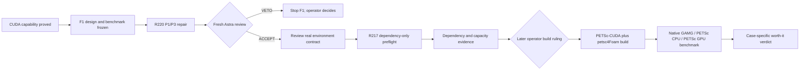

> **Superseded 2026-10-21 (Ruling 247).** The two-machine effort ended; the PC is the only machine and the AI-Forward pack's local coordination is what remains. Kept for history; nothing here is current guidance.

# OpenFOAM GPU work status at Ruling 220

**Snapshot:** 2026-10-12, Windows coordinator branch `win/gpu-f1-preflight-r217`, after merging `origin/main` at
Ruling 220. Mac remains repository leader. Windows owns the bounded packet repair and any later authorized machine run.

## Current result

The machine can execute CUDA work through WSL, but OpenFOAM GPU acceleration is not yet qualified. B2 proved the
pinned CUDA 13.2 toolchain and a managed-memory SAXPY workload on the RTX 3080 Ti Laptop GPU, with zero mismatches and
complete rollback from its disposable distro. The protected `cfdw-openfoam2512` distro remained unchanged.

The installed OpenFOAM v2512 runtime does not prove whole-solver GPU use. Source inspection found a conditional,
partial expression-offload path, while the installed libraries were CPU-linked. F1 therefore uses the separately
planned PETSc-CUDA plus petsc4Foam route. `amgx4Foam` and RapidCFD are rejected for this F1 scope.

## Stage ledger

| Stage | State | Verified result | Next gate |
|---|---|---|---|
| G0/G1 route inspection | Complete | GPU visible in WSL; installed v2512 does not establish whole-solver offload; exact PETSc/petsc4Foam route selected. | None. |
| B1 inventory and guard | Complete | Machine, package, OpenFOAM development gaps, and completed-L3 guard evidence accepted. | None. |
| B2 CUDA capability | Complete and rolled back | Exact 135-package CUDA 13.2 lock installed in a disposable distro; managed-memory SAXPY passed; distro unregistered; protected OpenFOAM state unchanged. | None. |
| F1 design | Accepted as blocked evidence | PETSc 3.26.0, petsc4Foam commit, ABI/build outline, managed-memory measures, guard, rollback, and benchmark contract are recorded. | Close dependency transaction through R217 preflight. |
| F1 benchmark contract | Accepted with amendments | Three serial arms: native GAMG, PETSc CPU, PETSc GPU. GPU must be at least 1.20x faster than native GAMG with separation, spread, convergence, field, force, determinism, power, and y+ checks. | A later operator ruling after dependency preflight and build review. |
| R217 dependency preflight packet | Repair active under R220 | P2 deadlines, P4 UTC, P5 trust-contract code, and P6 capacity reconciliation cleared. P1 final cleanup reap and P3 exact process identity failed the second review. | One red-first P1/P3 repair, then fresh Astra review. |
| Live dependency preflight | Closed | No F1 distro import, apt transaction, package download, install, source acquisition, build, or case run has occurred. | Packet ACCEPT plus a separately reviewed environment contract. |
| PETSc/petsc4Foam build and CFD benchmark | Closed | No execution evidence exists. | Separate operator ruling after preflight evidence. |

## Active Ruling 220 repair

Ruling 220 authorizes one additional cycle and only two changes:

1. **P1 cleanup:** a fresh bounded stop-and-reap check must run in a `finally` path after every cleanup-stage launch;
   nothing may launch after that check.
2. **P3 exact identity:** residual discovery must bind recorded PID/PGID and exact argv tokens; `runA` must never select
   `runAB`.

The author is running red-first fixtures, one implementation pass, and the complete offline packet tests. No WSL or
build command is allowed. A separate Astra owner must review the finished commit afresh. Another VETO stops F1 and
returns the decision to the operator.

## What a packet ACCEPT unlocks

An ACCEPT does not authorize an install or build. It allows the Windows coordinator to construct and obtain review of
the real environment contract. That contract binds the accepted packet commit, input hashes, signer sets, branch,
session, and live Mac leader epoch. Only then may the R217 preflight:

- import disposable distro `cfdw-petsc-cuda132-f1` at its dedicated path;
- freeze signed Ubuntu, OpenFOAM, and NVIDIA indices;
- simulate the complete zero-removal dependency transaction;
- download only the resolved `.deb` files to inspect licences, hashes, and `Installed-Size`;
- commit manifest-bound evidence; then delete the downloads and unregister the disposable distro.

The preflight remains capped at two cores, `nice 10`, 60 minutes, an 8 GiB VHD, and the recorded host-space floor.
It may not run `dpkg -i`, install packages, fetch PETSc or petsc4Foam source, compile, or run a CFD case.

## End-to-end route

## Coordination and proof

- GitHub draft handoff: PR #33, `win/gpu-f1-preflight-r217`.
- Mac Ruling 220 is on `main` at `63eb3e0f` and is merged into the Windows coordinator branch.
- Exact Windows readiness failures requested by Mac are posted on PR #33.
- The full repository readiness receipt remains RED on Windows due to a POSIX-only architecture-spike path, a
  temporary-file access failure, one desktop theme test, and the 240-second budget. These are recorded separately from
  the green R217 packet-specific offline gates.

## Confidence and limits

**Verified:** repository receipts and rulings establish every completed-stage claim above. **Not recorded:** F1 package
closure, PETSc/petsc4Foam build success, OpenFOAM GPU solver use, numerical equivalence, and speed-up. Those values stay
unknown until their authorized measurement stages execute.

