# OpenFOAM GPU work status after Ruling 228

**Snapshot:** 2026-10-13 UTC, Windows coordinator at `d6edbc63` (`win/gpu-status-r228`), after the single R228-authorized
F1 dependency-preflight attempt. The status incorporates Rulings 225–228 and the committed failure receipt. Mac remains
the repository leader; the PR #34 handoff tracks the R228 authorization and review record.

## Current result

CUDA capability through WSL remains proved. B2 installed the pinned CUDA 13.2 toolchain in a disposable distro and ran
managed-memory SAXPY on the RTX 3080 Ti Laptop GPU with zero mismatches, then rolled the distro back. The protected
`cfdw-openfoam2512` distro remained unchanged. F1 remains the selected PETSc-CUDA plus petsc4Foam route; this design
selection does not establish a successful build or GPU solver execution.

The R228 dependency-only preflight attempt ran for 39.334 seconds. `probe` and `repositories` completed; reading
`completed-guard-events.jsonl` failed because another process held the file with incompatible sharing. Finalization
stopped owned work and the guard and captured the protected-distro after-snapshot. Checkpoint binding then failed
because committed `invocation-contract.stdout.txt` bytes differed from the evidence after text normalization. The
checkpoint was not proved, so download archive deletion and target unregister were withheld. The exact target
`cfdw-petsc-cuda132-f1`, GUID `{e874e10f-c7b9-4a2b-a03b-87ad52fb9c41}`, remains registered pending cleanup-only R229
preparation and authorization. No cleanup action or retry is authorized by this snapshot.

## Stage ledger

| Stage | State | Verified result | Next gate |
|---|---|---|---|
| G0/G1 route inspection | Complete | Installed v2512 does not establish whole-solver GPU offload; native-fused nvc++ route is closed on this machine. | None. |
| B1 inventory and guard | Complete | Read-only machine/package inventory and completed-L3 guard evidence accepted. | None. |
| B2 CUDA capability | Complete and rolled back | Pinned CUDA 13.2 toolchain and managed-memory SAXPY passed in a disposable distro; protected distro stayed unchanged. | None. |
| F1 design and benchmark | Selected; evidence remains blocked | PETSc-CUDA plus petsc4Foam and the three-arm benchmark remain the selected qualification route. | Dependency preflight and later build authorization. |
| R228 preflight attempt 1 | Failed and stopped | `probe` and `repositories` completed; locked completed-guard event log stopped the attempt; checkpoint binding failed on normalized text bytes. | Cleanup-only R229 preparation for the exact remaining target. |
| Exact target cleanup | Pending; not performed | Target GUID `{e874e10f-c7b9-4a2b-a03b-87ad52fb9c41}` remains registered; protected distro identity was captured exactly. | Separate cleanup-only ruling; preserve the checkpoint and receipt and prove exact absence. |
| F1 dependency preflight attempts 2 and 3 | Not authorized | Ruling 225 allows up to three attempts, each with its own hash-bound ruling; attempt 1 failed. | New rulings for each attempt, after cleanup and repair decisions. |
| PETSc/petsc4Foam build and CFD benchmark | Not run | No install, source fetch, build, case run, or GPU OpenFOAM benchmark evidence exists. | Separate authorization after dependency and build review. |

## Current blocker and bound

The failure receipt records the initiating locked-file error, the checkpoint binding mismatch, and `target_present_after_failure: true`.
It also records successful shutdown of owned work and the guard, and a captured protected-distro snapshot. Both leader
lease samples exceeded the required 200-second floor: 874.305 seconds at activation and 851.647 seconds immediately
before WSL. The renewal supervisor exited 0 with empty stderr, and its event log is retained in the receipt.

The committed `.gitattributes` and corrected manifest control at `d6edbc63` is green across 17 manifests. This verifies
the captured byte forms and manifest gate; it does not retroactively make the failed checkpoint bind pass. The next
step is cleanup-only R229 preparation for the recorded target identity. It must preserve the checkpoint and receipt,
recheck target and protected identities, terminate and unregister only the target, and prove target name/GUID/path
absence. It must not run any preflight stage. Attempts 2 and 3 each require their own new ruling.

## End-to-end route

```mermaid
flowchart LR
  A[B2 CUDA capability proved] --> B[F1 design selected]
  B --> C[R228 attempt 1: probe + repositories]
  C --> D[Locked guard-event read; attempt stopped]
  D --> E[Checkpoint bind failed; target remains registered]
  E --> F[Cleanup-only R229 preparation and ruling]
  F --> G[Exact target cleanup and absence proof]
  G --> H[New ruling for each remaining preflight attempt]
  H --> I[Dependency evidence and cleanup]
  I --> J[Separate build ruling]
  J --> K[PETSc-CUDA + petsc4Foam build]
  K --> L[Native GAMG / PETSc CPU / PETSc GPU benchmark]
  L --> M[Case-specific worth-it verdict]
```

The preflight contract permits simulation of the dependency transaction and downloading resolved `.deb` files for
licence, hash, and size inspection. It prohibits package installation, PETSc or petsc4Foam source acquisition, builds,
case runs, benchmarks, and lifecycle actions against the protected distro. R228 attempt 1 did not complete those
stages.

## Coordination and proof

- PR #34 is the coordination handoff for the R228 attempt-1 authorization and review record. The unused Ruling 227
  epoch-7 authorization was superseded by Ruling 228 at epoch 8; Ruling 228 is the only attempt-1 authorization used.
- The failure receipt is [attempt-failure.md](../proof/win-gpu-f1-preflight/attempt-1/final/attempt-failure.md), with
  structured evidence in the adjacent JSON receipt.
- Exact target identity: `cfdw-petsc-cuda132-f1`, GUID `{e874e10f-c7b9-4a2b-a03b-87ad52fb9c41}`. The protected
  `cfdw-openfoam2512` identity remains the reviewed GUID `{b7566a82-9cee-47ce-a246-f83632353cea}` and its exact
  registered path is preserved in the receipt.

## Confidence and limits

**Verified:** B2 capability and rollback; F1 route selection; Ruling 228 authorization; the 39.334-second attempt
outcome and completed stages; the guard-event lock; checkpoint bind failure; retained target registration and GUID;
protected-distro identity snapshot; lease samples and renewal-supervisor receipt; the corrected 17-manifest control
at `d6edbc63`.

**Inferred:** none of the R228 attempt's uncompleted dependency stages are inferred to have run. The target remains
registered because the committed failure receipt lists its registration and GUID after failure.

**Flagged / not recorded:** successful target cleanup, attempt 2 or 3, dependency closure, PETSc/petsc4Foam build,
OpenFOAM GPU solver use, numerical equivalence, and speed-up. No GPU OpenFOAM benchmark has run.
