# OpenFOAM GPU work status through Ruling 224

**Snapshot:** 2026-10-12, Windows coordinator branch `win/gpu-f1-preflight-r217`. Mac remains repository leader at
epoch 6. Windows owns the reviewed dependency-only preflight and its evidence.

## Current result

The machine can execute CUDA work through WSL, but OpenFOAM GPU acceleration is not yet qualified. B2 proved the
pinned CUDA 13.2 toolchain and a managed-memory SAXPY workload on the RTX 3080 Ti Laptop GPU, with zero mismatches and
complete rollback from its disposable distro. The protected `cfdw-openfoam2512` distro remained unchanged.

The installed OpenFOAM v2512 runtime does not prove whole-solver GPU use. Source inspection found a conditional,
partial expression-offload path, while the installed libraries were CPU-linked. F1 therefore uses the separately
planned PETSc-CUDA plus petsc4Foam route. `amgx4Foam` and RapidCFD are rejected for this F1 scope.

## Stage ledger

| Stage | State | Verified result | Next gate |
|---|---|---|---|
| G0/G1 route inspection | Complete | GPU visible in WSL; installed v2512 does not establish whole-solver offload; exact PETSc/petsc4Foam route selected. | None. |
| B1 inventory and guard | Complete | Machine, package, OpenFOAM development gaps, and completed-L3 guard evidence accepted. | None. |
| B2 CUDA capability | Complete and rolled back | Exact 135-package CUDA 13.2 lock installed in a disposable distro; managed-memory SAXPY passed; distro unregistered; protected OpenFOAM state unchanged. | None. |
| F1 design | Accepted as blocked evidence | PETSc 3.26.0, petsc4Foam commit, ABI/build outline, managed-memory measures, guard, rollback, and benchmark contract are recorded. | Close dependency transaction through R217 preflight. |
| F1 benchmark contract | Accepted with amendments | Three serial arms: native GAMG, PETSc CPU, PETSc GPU. GPU must be at least 1.20x faster than native GAMG with separation, spread, convergence, field, force, determinism, power, and y+ checks. | A later operator ruling after dependency preflight and build review. |
| R217 dependency preflight packet | **Accepted under R220** | The repair commit `d5bb68fe` cleared P1 final cleanup/reap and P3 exact process identity. Astra independently reproduced the old failures and accepted all 15 repaired packet files at review commit `00933e65`. | Complete. |
| Run-1 environment contract | **Accepted** | Contract commit `754b23e0` binds all 15 accepted packet hashes, seven exact inputs, signer allowlists, execution identity, target paths, and live Mac epoch 6. Astra independently accepted it at `456d9ebf`; the joined branch returned `INVOCATION-CONTRACT-PASS`. | Complete. |
| Live dependency preflight | **Stopped fail-closed at simulate** | Target creation, capacity, repository authentication, signed-index freeze, and transaction simulation ran. No package install or `.deb` download began. URI matching rejected `%7e` versus `~`; checkpoint freeze passed but a PowerShell scope collision prevented its commit. | Accept the offline torn-pair reader repair, then obtain the next hash-bound Mac ruling before one preflight retry. |
| Packet defect repair | **Astra ACCEPT; joined** | URL basenames are decoded exactly once without changing raw URL/cache identity. Finalization now keeps the canonical checkpoint path distinct from callbacks. Accepted branch head: `65456e1c`. | Complete offline. |
| Cleanup-only recovery | **Rollback complete; formal receipt failed closed** | R223 ran once. Cache deletion, owned stop, exact-target terminate, and unregister all exited zero; the target registration and path are absent. The formal result stayed failed because the guard reader observed event N+1 with state N during publication. Evidence is at `11f56c79`. | Complete offline `TORN-PAIR-READ` repair and independent review. Never rerun R223. |
| R224 read-only verification | **PASS** | The protected L3 SHA-256 exactly matched `42e1d0be…a090aab9`; the failed target registration and path remained absent; no forbidden action ran. Receipt is committed at `0356651c`. | Complete the required offline guard-reader repair before any future F1 live step. |
| Guard publication reader | **Astra ACCEPT; joined** | Candidate `5c1b727f` returns stable state N only for adjacent event N+1 with strictly later UTC and `continue`; invalid shapes remain fail-closed. Astra reproduced the old failure and passed 50 recovery tests plus all required gates. Review `f3094512` joined and pushed at `924a5b97`. | Complete offline. |
| PETSc/petsc4Foam build and CFD benchmark | Closed | No execution evidence exists. | Separate operator ruling after preflight evidence. |

## Ruling 220 packet result

Ruling 220 authorized one additional cycle and only two changes:

1. **P1 cleanup:** a fresh bounded stop-and-reap check must run in a `finally` path after every cleanup-stage launch;
   nothing may launch after that check.
2. **P3 exact identity:** residual discovery must bind recorded PID/PGID and exact argv tokens; `runA` must never select
   `runAB`.

The author added red-first fixtures, repaired both defects, and passed the complete offline packet suite. Astra then
reviewed the exact packet independently and returned **ACCEPT**. The accepted source is
`d5bb68fe7db5e511ac46708e14564bb6a738db37`; the joined review is on the coordinator branch at `88ae5819`.

## Live preflight incident

The accepted contract joined at `6445bb6e`, and clean-tree verification passed. Run
`r217-run1-epoch6-20261012` then reached transaction simulation and stopped on two newly measured defects:

1. `transaction.py` compared an apt URI basename containing `%7e` with signed metadata containing `~` without
   percent-decoding. It rejected `cpp-13` before any download.
2. PowerShell dynamic scope let the finalization callback parameter named `Checkpoint` shadow the canonical checkpoint
   path. The 75-file freeze passed but landed in repo-root `Save-Checkpoint/`; the following relative-path calculation
   failed, so the checkpoint was not committed.

The wrapper stopped owned work, bound 16 completed-L3 guard rows, proved the protected terminal snapshot unchanged,
and withheld deletion/unregister. The disposable distro remains at the exact expected path. The original 75-file
checkpoint and 93-file failed-live inventories remain byte-bound and unchanged.

Both defects now have red-first repairs. Astra accepted the packet repair at `65456e1c`. The cleanup recovery's first
candidate was vetoed on deadline, renamed-target, and error-retention defects; cycle 1 repaired those classes and was
accepted at `02485495`. Their exact two-parent integration `5b1a9bb4` then passed 35 recovery tests, packet suites,
76/94 evidence binders, documentation, privacy, and ten safe gates in an independent Astra review. That review joined
and pushed at `db2826a6`.

Mac Ruling 223 then authorized one cleanup attempt. The allowed cleanup actions completed and removed the failed target,
but the formal receipt failed closed when the guard reader observed the new event before the new state file. Ruling 224
recognized the rollback and authorized one read-only verification. That verification passed at `0356651c`: the protected
snapshot hash matched exactly and both target registration and path remained absent. No cleanup action was repeated.
R224 required the `TORN-PAIR-READ` repair before any future F1 live step. Candidate `5c1b727f` passed independent
Astra review at `f3094512`; the docs-only review join and full verification gates passed at `924a5b97`.

The preflight was limited to:

- import disposable distro `cfdw-petsc-cuda132-f1` at its dedicated path;
- freeze signed Ubuntu, OpenFOAM, and NVIDIA indices;
- simulate the complete zero-removal dependency transaction;
- download only the resolved `.deb` files to inspect licences, hashes, and `Installed-Size`;
- commit manifest-bound evidence; then delete the downloads and unregister the disposable distro.

The preflight remains capped at two cores, `nice 10`, 60 minutes, an 8 GiB VHD, and the recorded host-space floor.
It may not run `dpkg -i`, install packages, fetch PETSc or petsc4Foam source, compile, or run a CFD case.

## End-to-end route

```mermaid
flowchart LR
  A[CUDA capability proved] --> B[F1 design and benchmark frozen]
  B --> C[R220 P1/P3 repair complete]
  C --> D[Fresh Astra packet ACCEPT]
  D --> E[Independent contract ACCEPT]
  E --> F[R217 dependency-only preflight]
  F -->|Stopped at simulate| X[Preserve evidence; Mac recovery ruling]
  X --> G[Repair and re-review accepted]
  G --> L[R223 exact-target cleanup]
  L --> M[R224 rollback verification]
  M --> N[Offline torn-pair reader repair]
  N --> H{Next hash-bound preflight-retry ruling}
  H --> I[PETSc-CUDA plus petsc4Foam build]
  I --> J[Native GAMG / PETSc CPU / PETSc GPU benchmark]
  J --> K[Case-specific worth-it verdict]
```

## Coordination and proof

- GitHub draft handoff: PR #33, `win/gpu-f1-preflight-r217`.
- Mac Ruling 220 is on `main` at `63eb3e0f` and is merged into the Windows coordinator branch.
- Mac remains the designated leader at live coordination epoch 6.
- The accepted packet review is joined and pushed at `88ae5819`; the accepted contract source is `754b23e0`.
- The contract review joined on the execution branch at `6445bb6e`; the failed run evidence remains uncommitted and
  preserved pending Mac's recovery ruling.
- The packet repair is accepted at `65456e1c`; cleanup recovery cycle 1 is accepted at `02485495`.
- Exact integration `5b1a9bb4` is independently accepted; its review is joined and pushed at `db2826a6`.
- R223 was consumed exactly once. Its actions removed the failed target; it conveys no retry authority and must not run again.
- R224 was consumed exactly once. Its read-only receipt is pushed at `0356651c`; it conveys no cleanup, retry, or build authority.
- The exact `TORN-PAIR-READ` repair is accepted at `5c1b727f`; its review is joined at `924a5b97`.
- The immediate blocker is the next hash-bound Mac ruling, which must bind the accepted repair and the operator's retry
  authorization before the live preflight can run again.
- Exact Windows readiness failures requested by Mac are posted on PR #33.
- The full repository readiness receipt remains RED on Windows due to a POSIX-only architecture-spike path, a
  temporary-file access failure, one desktop theme test, and the 240-second budget. These are recorded separately from
  the green R217 packet-specific offline gates.

## Confidence and limits

**Verified:** repository receipts, hashes, signatures, gates, reviews, and retained live evidence establish every
completed-stage and incident claim above. **Blocked:** no future F1 live step may run until Mac commits the next exact
ruling. **Residual risk:** separately published guard files retain a bounded visibility window, and the repaired reader
has not yet been exercised live. **Not recorded:** complete F1 package
closure, PETSc/petsc4Foam build success, OpenFOAM GPU solver use, numerical equivalence, and speed-up.

