# OpenFOAM GPU work status after Ruling 229

**Snapshot:** 2026-10-13 UTC, Windows status branch after merging `origin/main` at `c1f4b5c9`. The Windows cleanup lane
merged main at `e52a9d2d`; Ruling 229 is committed at `7ceed8b6`. Cleanup executor source `f75ae322` is an activation
candidate under offline validation. Mac remains repository leader.

## Current result

CUDA capability through WSL remains proved. B2 installed the pinned CUDA 13.2 toolchain in a disposable distro and ran
managed-memory SAXPY on the RTX 3080 Ti Laptop GPU with zero mismatches, then rolled the distro back. F1 remains the
selected PETSc-CUDA plus petsc4Foam route; this does not establish a successful build or GPU solver execution.

R228 preflight attempt 1 failed closed after `probe` and `repositories`; apt metadata was fetched, but no simulation,
package download, install, or build ran. Ruling 229 verified owned work and the guard were stopped, and the protected
`cfdw-openfoam2512` distro was unchanged: L3 terminal before and after matched, with the recorded guard and log
evidence. The target `cfdw-petsc-cuda132-f1`, GUID `{e874e10f-c7b9-4a2b-a03b-87ad52fb9c41}`, remains registered.

Ruling 229 accepts one cleanup-only action after an identity-rebinding repair. The cleanup executor candidate at
`f75ae322` is under offline validation. No R230 ruling, payload hash, cleanup authorization hash, or live authority has
been supplied. No cleanup action has run. The target stays registered until a valid R230 authorization is committed
and all of its conditions are satisfied.

## Stage ledger

| Stage | State | Verified result | Next gate |
|---|---|---|---|
| G0/G1 route inspection | Complete | Installed v2512 does not establish whole-solver GPU offload; native-fused nvc++ route is closed on this machine. | None. |
| B1 inventory and guard | Complete | Read-only machine/package inventory and completed-L3 guard evidence accepted. | None. |
| B2 CUDA capability | Complete and rolled back | Pinned CUDA 13.2 toolchain and managed-memory SAXPY passed in a disposable distro; protected distro stayed unchanged. | None. |
| F1 design and benchmark | Selected; evidence remains blocked | PETSc-CUDA plus petsc4Foam and the three-arm benchmark remain the selected qualification route. | Dependency preflight and later build authorization. |
| R228 preflight attempt 1 | Failed closed; consumed | Only probe and repositories ran; no simulation, download, `.deb`, install, or build artifacts exist. | Attempt 1 is consumed under the three-attempt cap. |
| R228 failure disposition | Accepted by Ruling 229 | Protected distro unchanged; target GUID and registration verified; epoch-8 lease samples cleared the 200-second floor. | One cleanup-only action after identity rebinding and R230 authorization. |
| Cleanup identity-rebinding repair | Candidate under offline validation | Source commit `f75ae322`; it adapts the cleanup executor for R230 activation. | Complete offline review; then submit payload and authorization hashes for a ruling. |
| Exact target cleanup | Not run; no R230 authority | Target remains registered; no cleanup receipt exists. | R230 ruling with hash-bound payload and authorization, then one exact cleanup-only action. |
| F1 preflight attempts 2 and 3 | Not authorized | Ruling 225 permits up to three attempts; attempt 1 is consumed. | Both R229 defects must be repaired, new packet hashes prepared, and each attempt receive its own ruling. |
| PETSc/petsc4Foam build and CFD benchmark | Not run | No install, source fetch, build, case run, or GPU OpenFOAM benchmark evidence exists. | Separate authorization after dependency and build review. |

## Current blocker and repair cap

Ruling 229 verified two defects from attempt 1. First, `Invoke-Preflight.ps1` reads the guard event log with a sharing
mode that conflicts with the live append handle. The reader-sharing check has been extended to the proof PowerShell
surface, but the preflight reader repair still requires completion and review. Second, the checkpoint capture differed
from its committed blob because CRLF normalization changed the bytes. The R229 capture-text attribute control is now
present on main. These controls do not make the failed checkpoint bind pass retroactively.

The R228 epoch-8 renewal evidence remains healthy: both required lease samples cleared 200 seconds (874 seconds at
activation and 852 seconds immediately before WSL), and the committed renewal supervisor exited 0 with empty stderr.
The protected distro is unchanged and the exact target remains registered. No live action follows from the offline
candidate alone.

**Repair/attempt cap:** Ruling 225 permits at most three dependency-preflight attempts; attempt 1 is consumed. Attempts
2 and 3 each require both defect fixes, fresh packet hashes, and their own hash-bound ruling. Separately, Ruling 229
accepts one cleanup-only action after identity rebinding, but R230 must commit the hash-bound authorization before that
action can run. This status supplies no payload or authorization hash and grants no live authority.

## End-to-end route

```mermaid
flowchart LR
  A[B2 CUDA capability proved] --> B[F1 design selected]
  B --> C[R228 attempt 1: probe + repositories]
  C --> D[R229 verifies failed-closed state]
  D --> E[Reader-sharing and capture-byte controls]
  E --> F[f75ae322 cleanup identity repair under offline validation]
  F --> G{R230 hash-bound authorization committed?}
  G -->|No| H[Target remains registered; stop]
  G -->|Yes| I[One cleanup-only action + exact absence proof]
  I --> J[Repair both defects and re-hash packet]
  J --> K[New ruling for each remaining preflight attempt]
  K --> L[Dependency evidence]
  L --> M[Separate build ruling]
  M --> N[PETSc-CUDA + petsc4Foam build]
  N --> O[Native GAMG / PETSc CPU / PETSc GPU benchmark]
  O --> P[Case-specific worth-it verdict]
```

The dependency preflight may simulate the package transaction and download resolved `.deb` files for licence, hash,
and size inspection. It does not authorize package installation, PETSc or petsc4Foam source acquisition, builds, case
runs, benchmarks, or lifecycle actions against the protected distro. The one cleanup-only action may terminate and
unregister only the exact R228 target after its R230 authorization; it cannot run a preflight stage.

## Coordination and proof

- Ruling 229 is committed at `7ceed8b6`; the Windows cleanup lane merged main at `e52a9d2d`.
- `f75ae322` is cleanup executor source under offline validation. No R230 ruling or live authorization has been
  supplied, so no cleanup action is authorized to run from this status.
- The R228 failure receipt is [attempt-failure.md](../proof/win-gpu-f1-preflight/attempt-1/final/attempt-failure.md),
  with structured evidence in the adjacent JSON receipt.
- Exact target identity: `cfdw-petsc-cuda132-f1`, GUID `{e874e10f-c7b9-4a2b-a03b-87ad52fb9c41}`. The protected
  `cfdw-openfoam2512` identity remains GUID `{b7566a82-9cee-47ce-a246-f83632353cea}` on its unchanged registered path.

## Confidence and limits

**Verified:** B2 capability and rollback; F1 route selection; Ruling 229's failed-closed disposition; completed preflight
stages and absence of later stages; protected-distro before/after evidence; target registration and GUID; epoch-8 lease
and renewal-supervisor evidence; source commit `f75ae322` exists as a cleanup executor candidate; Windows cleanup-lane
merge `e52a9d2d`.

**Inferred:** none of the uncompleted preflight stages are treated as run. The offline candidate does not imply a live
cleanup authorization.

**Flagged / not recorded:** R230 ruling and authorization hashes, live cleanup, target absence, attempts 2 or 3,
dependency closure, PETSc/petsc4Foam build, OpenFOAM GPU solver use, numerical equivalence, and speed-up. No GPU
OpenFOAM benchmark has run.
