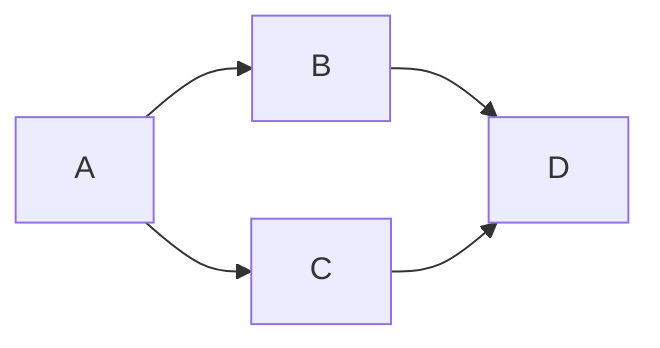

# Goal and graph

Goal: independently accept or veto candidate 6946da40 after repair cycle 1.
Done when exact bindings, previous veto controls and safety boundaries are
checked and the review is committed and pushed. Tier T1; fan-out zero. No WSL,
registry observation, lifecycle action, source repair or GitHub message.

| Node | Inputs / goal | Exit oracle | Capability | Tier | Dependency |
| --- | --- | --- | --- | --- | --- |
| A | Candidate/source and old veto; inspect exact diff and reachable sequence | Only intended identity repair and regenerated bindings | Independent review | T1 | none |
| B | A; bind files, manifest, identities, authorization and history | Hash/ancestry equality; proposed state refuses | Deterministic mechanics | T0 | A data |
| C | A; run old/new production alias controls and offline tests | Old admits three, repaired refuses three and normalized variants | Deterministic mechanics | T0 | A data |
| D | B/C; verdict, audit, derived graph and gates | Review recorded and push succeeds | Independent review | T1 | B/C decision |

Naive graph has four serial nodes; dependency graph has four nodes and span
three. B/C are read-only independent controls and can share a tool batch; no
agent delegation. All four nodes are mandatory. No repair or retry loop exists.
Each probe has a finite case list; a failure changes the verdict to VETO rather
than expanding scope. The reviewer controls use only committed fixtures and
mocked production process boundaries. No broad gate substitutes for the three
negative controls. The linked author plan records that the pack's named graph
knowledge id is absent here; this plan creates no dangling link to it.

Actual: four nodes completed, no repair passes. The safe-gate ruling-citation
failure changes the final verdict to VETO; the coordinator directed publication
without repair. Fourteen author controls passed
in 0.008 seconds; independent probe tool wall time was 0.921 seconds. These are
measured tool/test values, not runtime cleanup estimates. Wall duration is
recorded by the audit marker; token usage is unavailable. The old-source red
and new-source green preserve the previous veto's oracle without changing the
historical VETO artifact.
