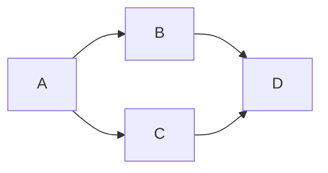

Goal: accept or veto exact candidate e624ebce after repair cycle 2. Done when
the verdict is committed and pushed. Tier T1, no delegation, source repair,
WSL, registry observation, lifecycle action or GitHub message. The repair cap
is consumed; any required failure yields a VETO and stops the track.

| Node | Goal / input | Exit oracle | Capability | Tier | Dependency |
| --- | --- | --- | --- | --- | --- |
| A | Inspect exact cycle-2 diff and anchors | Executable source/tests unchanged; proposal wording corrected | Independent review | T1 | none |
| B | Repeat production safety probes and bind all artifacts | Alias refusals, inert authority, ten payload hashes, 85-file manifest, history equal | Deterministic mechanics | T0 | A data |
| C | Run required safe bundle and direct citation gate | Ten executed gates pass; prescribed skips recorded | Deterministic mechanics | T0 | A data |
| D | Publish exact verdict, audit and derived graph | Commit/push and clean status | Independent review | T1 | B/C decision |

Four nodes, naive serial span four, dependency span three, no agent fan-out.
B/C use independent read-only tool batches. All nodes are mandatory. Finite
probe lists terminate without retries; the publication decision cannot trigger
source repair. The author plan records the absent graph knowledge id, so this
plan creates no dangling dependency. Actual execution used all four nodes and
zero repairs. Fourteen tests took 0.027 seconds; the independent probe took
1.021 seconds tool wall time (measured). Audit records full duration; token
usage is unavailable. No gate was weakened to close the final cycle.
