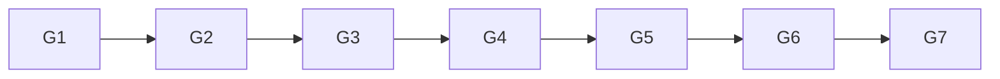

# Goal and execution graph

Goal: provide a reviewable cleanup-only candidate for the registered target left
by failed R228 attempt 1. Done when the source, offline controls, exact payload,
canonical authorization and R230 request are committed and pushed. Not in scope: any
WSL invocation, registry mutation, preflight resumption, package action, source
fetch, build, case, benchmark or host-path deletion. Tier T2; fan-out one. The
requested independent review is a later coordinator-owned node.

The optimize-graph evidence target `kb-graph-and-loop-engineering` is absent in
this checkout (verified by recursive `id:` search), so this plan does not create
a dangling dependency. The graph retains the failure receipt and defect register
as its inspected evidence edges.

| Node | Goal | Inputs | Exit / oracle | Tier | Capability | Dependency |
| --- | --- | --- | --- | --- | --- | --- |
| G1 | Ground exact residual identity and authority boundary | R228 receipt, R228 ruling, runbook | Target/protected rows and forbidden scope copied exactly | T0 | Deterministic mechanics | — |
| G2 | Build isolated cleanup source | G1; reviewed ownership and manifest helpers | Only exact identity, read-only owned checks, terminate, unregister, absence and evidence binding are reachable | T1 | Reasoning | G1 data |
| G3 | Prove refusal and lifecycle order offline | G2 source | Inert tests reject authority/ruling/identity/absence mutations and launch zero WSL on precheck refusal | T0 | Deterministic mechanics | G2 data |
| G4 | Freeze source payload and canonical authorization | Green G3 and source commit | Exact source/payload/auth hashes; canonical bytes bind R230 and R223(a)-(d) | T0 | Deterministic mechanics | G3 data |
| G5 | Run repository floors and conservation checks | G4 artifacts | Focused tests, docs, graph, privacy, whitespace and historical byte checks pass | T0 | Deterministic mechanics | G4 data |
| G6 | Independent adversarial review | Candidate commit and G5 results | Separate reviewer ACCEPT or VETO; author cannot clear it | T2 | Independent review | G5 decision |
| G7 | Request R230; activation and live action remain separate | G6 ACCEPT | Mac/Fable same-commit owner section, exact auth and activation sample reach origin/main | T2 | Reasoning | G6 decision |

Naive and optimized graphs both contain seven nodes with span seven and width
one. The source, payload and authority surfaces are tightly coupled; widening
would multiply context without shortening the critical path. Deterministic share
is four of seven nodes. Mandatory floors are G3, G5 and G6. The source repair
loop has variant `unresolved independent findings`, floor zero, exit at ACCEPT,
and cap two; a cap firing is a defect signal and stops the track. No live retry
loop exists. Costs before execution were Inferred: focused tests under five
seconds and docs gates under one minute, based on nearby recorded runs. Degrade
by stopping with a committed blocker; never drop an authority, identity,
independent-review or evidence gate.

Shared surface checks are jointly satisfiable: source admits only the listed
cleanup sequence; tests require that exact sequence and forbid broader tokens;
payload binds every executable/helper/evidence byte; authorization binds the
payload; the ruling must bind the accepted authorization. Scan roots are the two
new cleanup source files and the exact historical directories; token sets are
the forbidden operations and Git byte identities; no allowlist applies.

Re-plan only if the focused oracle finds a new executable path, the independent
review vetoes a binding, or Mac/Fable changes the permitted cleanup scope.

# Planned versus actual

All five author nodes ran serially as planned. The source pass found one missing
full-corpus manifest check before payload freeze. Independent review then found
one path-multiplicity class across admission and absence; bounded repair cycle 1
closed all three aliases. The R230 activation follow-on added five tests; its
repair cycle 1 made the TTL finite and moved pre-live refusal into receipt
binding. The final focused union contains 69 tests. Token usage is not exposed
by the runner. No concurrency was
used and no WSL process was launched during authoring. Final gate durations and
outcomes are recorded in the closing audit entry and author handoff.
