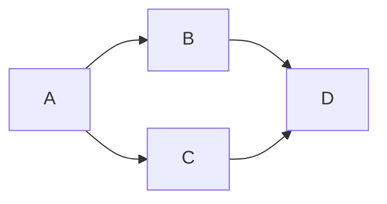

Goal: accept or veto exact 4044b77a/f75ae322. Done when independent findings,
bindings and verdict are committed and pushed. Tier T1, fan-out zero. No source
repair, WSL, registry read, lifecycle, GitHub message, mail or activation.

| Node | Input / goal | Exit oracle | Capability | Tier | Dependency |
| --- | --- | --- | --- | --- | --- |
| A | Exact source and owner decisions | Required surfaces identified | Independent review | T1 | none |
| B | A; identity/authority/lease/receipt boundaries | Production refusal controls and exact byte bindings | Deterministic mechanics | T0 | A data |
| C | A; tests, manifests and safe bundle | Read actual results, retain failures | Deterministic mechanics | T0 | A data |
| D | B/C; publish verdict and audit | Commit/push, clean reviewer tree | Independent review | T1 | B/C decision |

Four nodes, naive serial span four, optimized dependency span three. Independent
read-only controls share tool batches; no agent fan-out. All floors remain.
Finite case lists have no retry loop. Any hard veto ends acceptance work and
records the exact candidate rather than widening into source repair. The author
plan's absent graph knowledge id is not invented as a dependency here.

Actual: both new lease/receipt boundaries failed in B; C completed with 17 tests,
two 85-file manifest passes and safe bundle10/10. D publishes VETO as directed.
No repair passes. Test time 0.021 seconds and probe wall time1.154 seconds are
measured; audit records whole-run duration. Token usage unavailable.
