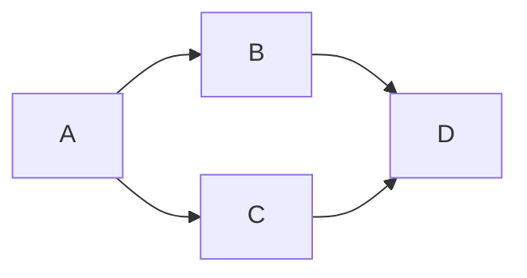

Goal: accept or veto exact e669ad1c/c8df1291. Done when reviewed bindings and
verdict are pushed. Tier T1, no delegation, repair, WSL, registry, lifecycle,
GitHub message, mail or activation. The existing optimize-graph sequence is reused.

| Node | Input / goal | Exit oracle | Capability | Tier | Dependency |
| --- | --- | --- | --- | --- | --- |
| A | Exact diff and prior veto | No unrelated production change | Independent review | T1 | none |
| B | A; production probes and full bindings | Both vetoes clear; contract negatives refuse | Deterministic mechanics | T0 | A data |
| C | A; tests, manifests and safe bundle | Required results pass | Deterministic mechanics | T0 | A data |
| D | B/C; verdict, audit, index, publication | Commit/push, clean status | Independent review | T1 | B/C decision |

Four mandatory nodes; naive serial span four, dependency span three. B/C use
independent read-only tool batches. No agent fan-out or source repair loop.
Finite case lists end at acceptance or a recorded veto; no floor is dropped.
Actual: all nodes executed. Nineteen tests took0.038s; probe took2.316s measured
tool wall time. One reviewer fixture initialization omission (`payload_sha`)
was corrected after its AttributeError; no candidate code changed. The probe
now calls the actual receipt builder, preventing that omission from hiding.
Audit records total duration; token usage unavailable. The named graph knowledge
id absent in the author plan is not invented as a dependency here.
