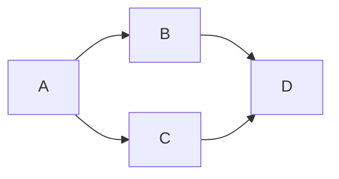

Goal: independently accept or veto exact 5cecf7ae and its source/byte candidate.
Done when verdict, audit and derived index are committed and pushed. Tier T1,
no delegation, repair, WSL, registry, lifecycle, GitHub message, mail or activation.
The existing optimize-graph sequence is reused; absent graph knowledge ids are
not invented as dependencies.

| Node | Input / goal | Exit oracle | Capability | Tier | Dependency |
| --- | --- | --- | --- | --- | --- |
| A | HOLD and exact diff | All named surfaces mapped | Independent review | T1 | none |
| B | A; production probes and hashes | Dynamic authority, prior vetoes, candidate/source and raw projection equality pass | Deterministic mechanics | T0 | A data |
| C | A; admission/cleanup tests, manifest and gates | Required results pass | Deterministic mechanics | T0 | A data |
| D | B/C; publication | Exact verdict pushed; clean status | Independent review | T1 | B/C decision |

Four mandatory nodes; serial span four reduced to dependency span three via
independent read-only tool batches. No agent fan-out or repair loop. Finite
case lists end at verdict; a failure is recorded, not repaired by the reviewer.
Actual: all four nodes completed, no rework. Cleanup 20/20 at 0.011s, admission 11/11
at 7.980s, independent probe 3.200s tool wall time, manifest 85 and safe 10/10 pass.
Times are measured; whole-run duration is recorded in audit, tokens unavailable.
