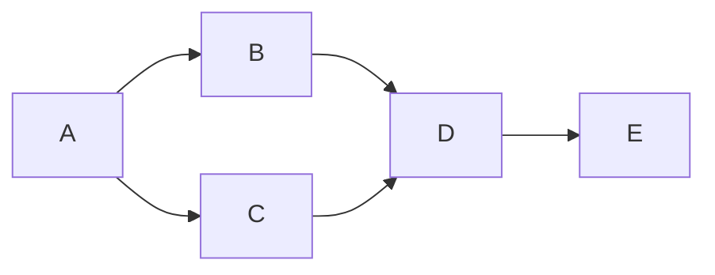

Goal: independently review exact candidate 6089217f and publish ACCEPT/HOLD/REJECT.
Done when exact evidence, boundary probes, gates and limits are committed/pushed.
Not in scope: source repair, live/WSL/registry/lifecycle or activation. Tier T1;
agent fan-out zero. Skill: optimize-graph, applied once. Surfaces: loader ->
owner/process reader -> helper CLI -> action/command log -> failure -> receipt;
authority and historical evidence remain immutable.

| Node | Capability | Input and goal | Exit oracle | Dependencies |
|---|---|---|---|---|
| A | Independent review | Exact candidate, prior failure, standards; inspect contracts | Grounded surface list and defect hypotheses | none |
| B | Deterministic mechanics | Real helper/tests; execute offline adversarial probes | Observed success/refusal at each reviewed boundary | A, data |
| C | Deterministic mechanics | Candidate/evidence; run hashes, manifest, safe gates | Exact hashes, unchanged evidence and explicit gate results | A, data |
| D | Independent review | B/C findings plus disclosed ring red; decide | Confidence-labeled verdict and future authority limits | B/C, decision |
| E | Deterministic mechanics | D review; audit, derive, docs checks, publish | Committed/pushed review and clean worktree | D, data |

All nodes T1 review context; B/C/E are mechanical. Naive five-node serial graph
becomes the same five nodes with independent B/C gate/read work batched. At most
four independent read/check commands overlap, no mutation overlap. Each command
runs once to terminal output; no retries or repair loop. A failed check becomes
evidence, never a dropped floor. Required floors: production boundary, refusal,
privacy, evidence conservation, explicit ring status and audit. No cost/span
estimate is invented; command timings are measured in the review. Graph grounding
uses `.claude/knowledge/execution-graph-optimization.md` and the optimize-graph
skill. The skill's named graph-engineering evidence directory/ID is absent in
this checkout; no traversal of that unavailable node is claimed. Derivation
exposed the copied dangling ID and it was removed before publication. The prior
failure review supplies the relevant verification gap.

Actual: five nodes; zero source repair cycles. B found missing-evidence
fail-open, so D records REJECT despite focused/full Python and safe-gate green.
No broad-ring rerun was needed to establish rejection; the disclosed red remains
a promotion blocker. Token and total critical-path measurements are unavailable;
audit start/append measures this run duration. No gate or authority was weakened.
