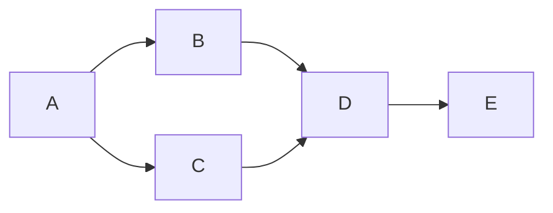

Goal: exact cycle-2 ACCEPT/HOLD/REJECT review. Done when boundary/gates/evidence
are checked and verdict committed/pushed. Not in scope: repairs, broad-ring retry
or any live action. Tier T1; agent fan-out zero. Optimize-graph applied once using
the grounded skill and execution-graph standard; its named graph-engineering
evidence directory is absent in this checkout, as recorded in the previous review.

| Node | Capability | Input/goal | Exit oracle | Dependency |
|---|---|---|---|---|
| A | Independent review | Exact diff and prior rejection | Bound defect/acceptance scope | none |
| B | Deterministic mechanics | CLI and existing fixtures | Six before-process sanitized refusals, prior tests pass | A, data |
| C | Deterministic mechanics | Source/evidence/gates | Exact hashes, empty historical diff, recorded gate results | A, data |
| D | Independent review | B/C and disclosed ring red | Confidence-labeled verdict | B/C, decision |
| E | Deterministic mechanics | Review/plan | Audit, derive, checks, commit/push | D, data |

Five-node naive serial graph becomes five nodes with independent checks batched
at width at most four. No overlapping mutations. Each check runs once to a
terminal result; no source repair loop is allowed at cap 2. Failure means record
and stop, not weaken a floor. Mandatory floors: actual helper/CLI, exact refusal,
receipt preservation, privacy, historical conservation, ring disclosure and audit.
Actual: five nodes, zero repairs. Technical blocker cleared; overall HOLD for
the existing red ring. Timings are measured per command; total duration comes
from audit start/append. Tokens and modeled span are not available. No graph
scope, authority or gate was weakened.
