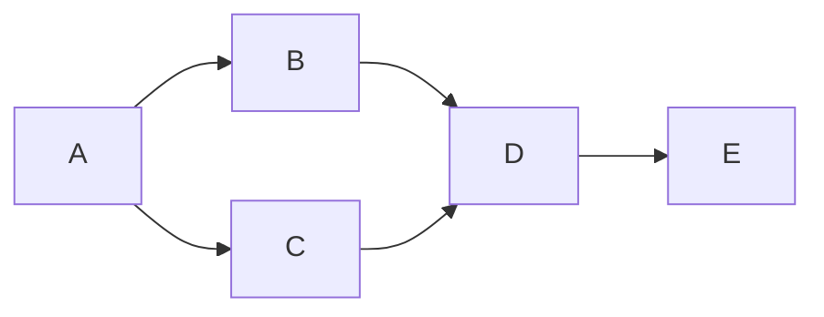

Goal: determine whether retained ring evidence clears the final helper review's
functional-ring hold. Done when exact hashes, outcomes, limits and disposition
are committed/pushed. Not in scope: source repair, ring rerun, WSL, registry or
lifecycle action. Tier T1; agent fan-out zero. Optimize-graph applied once using
the previously grounded skill/standard; no unavailable graph evidence is claimed.

| Node | Capability | Input / goal | Exit oracle | Dependency |
|---|---|---|---|---|
| A | Independent review | Exact candidate, retained proof and harness | Evidence surfaces enumerated | none |
| B | Deterministic mechanics | Manifests/Git blobs, classifiers, timings | Exact hashes and functional/count assertions | A, data |
| C | Deterministic mechanics | Capture/history | Privacy and unchanged historical authority | A, data |
| D | Independent review | B/C plus top-level receipt | Confidence-labeled HOLD or clearance | B/C, decision |
| E | Deterministic mechanics | Review/audit | Derived docs, commit/push, clean tree | D, data |

Five-node naive serial graph keeps five nodes while independent B/C reads run
together. No mutation overlap, no source repair, no test rerun. Floors: exact
committed bytes, completeness, expected-failure classifier, cost/functional
separation, privacy, historical immutability, authority limits and audit.
Evidence failures stop clearance. The original candidate had nine full-capture
and six serial-capture manifest mismatches; the coordinator authorized one
bounded evidence repair. Final review resumes only on the exact pushed candidate.
No loop repeats until it happens to pass. Audit measures elapsed duration;
unavailable token/span measurements are not invented.
