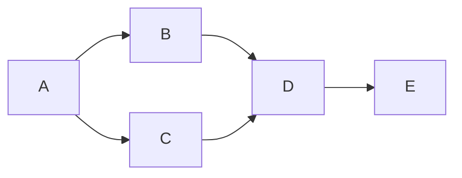

Goal: independent ACCEPT/HOLD/REJECT for70d022bf. Done when exact bindings,
behavior, controls, evidence and verdict are committed/pushed. Not in scope:
source repair, WSL or live lifecycle; no third ring. Tier T1; agent fan-out zero.
Optimize-graph applied once using the grounded skill and standard. The skill's
external graph evidence directory remains unavailable; no traversal is claimed.

| Node | Capability | Input/goal | Exit oracle | Dependencies |
|---|---|---|---|---|
| A | Independent review | Candidate/source/proof, standards | Surface/risk map | none |
| B | Deterministic mechanics | Production AST/fixtures/static gates | Sharing, decoding, event and disposal assertions; exact exemption delta | A, data |
| C | Deterministic mechanics | Private retained rings/telemetry | Separate red/green counts, exits, hashes and cost limits | A, data |
| D | Independent review | B/C/history | Confidence-labeled verdict, no author self-clearance | B/C, decision |
| E | Deterministic mechanics | Review/audit | Docs/privacy/graph checks then commit/push | D, data |

Five-node serial baseline keeps five nodes while independent checks batch at
width at most four. No overlapping mutations. Floors: actual reader, behavioral
red/green, exception disposal, exact source/history bindings, explicit gate/ring
results and privacy. Each required gate runs once unless a changed fixture
requires its focused replay. No source repair loops occur. Two authorized author
ring attempts remain distinct; a further blocker would be recorded for the
operator rather than silently repaired. Actual graph five nodes, zero reviewer
source repairs. Audit measures elapsed time; token and modeled span figures are
unavailable. Final disposition accepts the bounded candidate with cost advisories.
