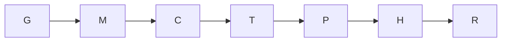

# Goal and boundaries

Goal: produce one immutable candidate joining cleanup recovery parent
`02485495951fbd04ea07a2e8bc276b0df4ab93cd` and packet repair parent
`65456e1cc858ff62b87c7a8d7030a6e83715b354`. Done when source conservation,
combined offline proof, audit, commit and push are complete. Tier T1; fan-out
zero. No live wrapper, WSL command, recovery execution, retained evidence edit,
cleanup, retry, install, acquisition, build or CFD workload is authorized.

Surface list: URI basename/raw URL/cache identity → signed-index matching →
transaction lock; canonical checkpoint path → callback scope → freeze/Git binding
→ cleanup permission; recovery authority → ownership/identity → guard/cache
deletion → lifecycle absence → classified receipt → manifest binding. Only the
accepted source merge and review artifacts change. Product data model and UI are
unchanged. The review of exact integrated bytes remains independent and pending.

## Execution graph

| Node | Goal / input | Exit oracle | Tier / Capability | Dependency |
| --- | --- | --- | --- | --- |
| G | Ground assigned checkout and accepted parents | Clean correct branch; exact parent reviews read | T1 / Reasoning | None |
| M | Merge exact packet parent into cleanup parent | Repository merge helpers preserve both records; no unresolved seam | T0 / Deterministic mechanics | G, data |
| C | Prove source, history, evidence and authority conservation | Packet parent map, union self-test, unchanged recovery/test bytes, 75/93 payloads, VETO and contract; absent authorization and refused malformed contracts | T0 / Deterministic mechanics | M, data |
| T | Combined recovery/packet and offline safety proof, immovable | 35 recovery tests; Python/PS5/PS7/Bash/authority/transaction/manifest/guard; ten safe gates; docs/graph/privacy all pass | T0 / Deterministic mechanics | C, data |
| P | Proof, audit and derived views, immovable | Hashes and measured results recorded; derived views current; final docs/diff clean | T1 / Reasoning | T, data |
| H | Commit and push candidate | Exact two-parent commit, clean checkout and pushed SHA | T0 / Deterministic mechanics | P, data |
| R | Independent integrated-byte decision, immovable outside author track | Fresh Astra review; new committed Mac ruling before any cleanup | T2 / Independent review | H, data |

The naive graph and optimized graph both have seven nodes, span seven, width one.
No verification floor is removed. Collapse per-file inspection into deterministic
hash maps and per-suite calls into bounded read-only batches; writes remain
sequential. There is no measured historical duration for this exact integration,
so work/span durations and speedup are not recorded. The graph-and-loop directives
are grounded by `.claude/knowledge/execution-graph-optimization.md`; its knowledge
file has no registered docs node, so no invented typed edge is added.

Tool batches may overlap only read-only suites, width at most three; each has a
bounded process timeout, no transient retry, explicit result inspection, all-pass
join and independent failure reporting. A failed gate stops promotion. Repair
has at most two cycles, strictly decreasing unresolved named failures toward zero;
the cap is a defect signal and requires reporting. No source repair is planned.
The source map and final gate are re-plan checkpoints. The parent coordinator
receives the graph for independent scrutiny; author cannot clear the review gate.

The scan oracle is recursive packet executable sources with the authority
scanner's explicit self-fixture exclusion; privacy uses the repository gate's
tracked/untracked corpus and existing allowlist. Source conservation covers every
packet file, all recovery files/tests, all retained checkpoint/live blobs, both
parent audit records and historical reviews. Accepted URI fixtures and cleanup
scope fixtures are jointly satisfiable because the URI repair does not change
`preflight.sh`. Its non-deletion scope hashes remain fixed.

## Cost and delivery ledger

Measured results and run duration are recorded in the integration proof and closing
audit. Token cost is not exposed. No source repair loop or weaker test substitution
is permitted. R remains pending after delivery, as does any execution ruling.
