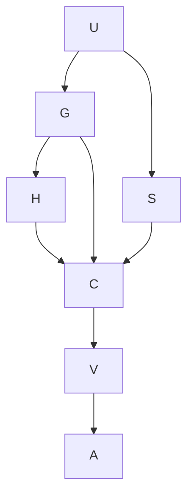

# Goal and evidence boundary

Goal: update the clone, ground the deferred Windows work in the current repository, and report the Windows/Mac split.
Done when `main` matches `origin/main`, current branches, pull requests, receipts and cross-machine messages are checked,
and the two machine queues are separated. Executing W-0 through W-5 or any Mac product work is outside this turn.
Tier T1. Agent fan-out zero. The evidence pass is bounded to two search refinements.

## Execution graph

| Node | Goal | Inputs | Exit condition and oracle | Tier | Capability | Dependencies |
|---|---|---|---|---|---|---|
| U | Update the primary clone | clean `main`, `origin/main` | `git pull --ff-only`; local and remote SHA equal | T0 | Deterministic mechanics | none |
| G | Ground project and coordination rules | updated tree | required guide, accepted stack, two-machine and PC kickoff documents read | T1 | Reasoning | U data |
| S | Establish current completion state | updated refs, proof paths, xmsg, GitHub PRs | branches, receipts, messages and PR list agree | T0 | Deterministic mechanics | U data |
| H | Measure this Windows host's W-0 readiness | W-0 checklist | installed versions and OS facts read; unavailable WSL state labelled | T0 | Deterministic mechanics | G data |
| C | Classify Windows and Mac queues | G, S, H | every reported item maps to an accepted owner and status | T1 | Reasoning | G, S, H data |
| V | Disconfirm the summary | two-machine plan, completed Mac-round close, current Git/PR state | no ownership or completion contradiction remains | T1 | Independent review | C data |
| A | Record and verify the report plan | this artifact and audit entries | docs graph derives and docs gate passes | T0 | Deterministic mechanics | V data |

Edges are data dependencies. Grounding and current-state inspection were independent after the update and were batched
as read-only mechanics; no agent was delegated. The naive graph had seven serial nodes (`T1 = 7`, `Tinf = 7`, width 1).
The optimized graph retained seven nodes, shortened the modeled span to five node units, and used read-only tool width six.
With six mechanical workers the node-unit ceiling is `(7 - 5) / 6 + 5 = 5.33`; this is an Inferred node model, not an
elapsed-time claim. All rigor floors remain: exact Git state, current authoritative plans, completion cross-check, host
measurement, and contradictory-evidence review.

No repair loop fired. The evidence-search loop variant was unresolved ownership/status questions, floor zero, exit at
zero, cap two passes. A firing cap would have been a defect signal and left the affected status Flagged. The local pack's
expected `kb-graph-and-loop-engineering` docs node is absent; existing plan `plan-authoring-decisions` records the same
gap, so this plan does not invent a dangling graph edge.

## Verified state

- `main` fast-forwarded from `599034c0` to `7102e90f`; local `HEAD` equals `origin/main`.
- No current `win/*` remote branch, Windows W-0..W-5 receipt path, or GitHub pull request exists. The cross-machine log
  contains two Mac-to-PC handoffs and no PC completion message. W-0 is therefore unstarted in current shared evidence.
- This PC has Windows 11 Pro x64, Python 3.13.14, GitHub CLI authentication, 20 logical processors, 31.7 GiB RAM and
  1.7 TiB free on C:. W-0 is blocked on the pinned .NET SDK 10.0.203 (only 9.0.315 and 10.0.301 are installed),
  `core.autocrlf=false` (currently true), and per-clone coordination installation (merge drivers are not effective).
  WSL inspection returned `REGDB_E_CLASSNOTREG`; WSL readiness is not recorded.
- The Mac round in `coordination-round-oct06` is complete. It joined copy fixes, adaptive panels, DX, group move, Units,
  the 1280x800 work, and ring-headroom work. Its carried queue includes packaged-app review, a fresh package request,
  the NeuralFoil weights question, and review/join of future Windows pull requests.

## Planned versus actual

The update, grounding, state inspection, host survey, classification and disconfirmation nodes all ran. One transient
bounded check did not complete normally: the combined WSL command was stopped after about 60 seconds after emitting
`REGDB_E_CLASSNOTREG`; no retry was useful because the observed failure was not transient. Rework passes: one compiler
field correction (`not_in_scope` could not be empty), within the two-cycle cap. Completeness and rigor floors were met.
Tool wall time was recorded per call; model tokens and monetary cost were not recorded.
