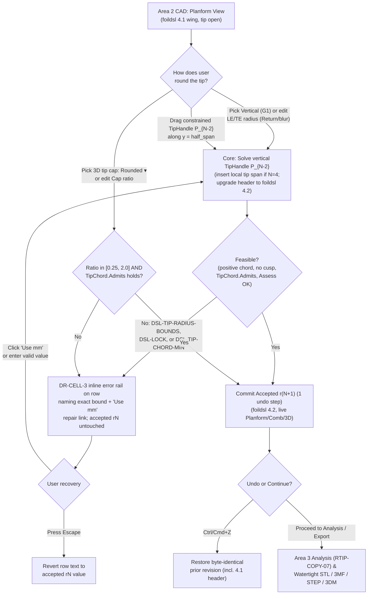

# Rounded & Radiused Wing Tips — Specification

> [!IMPORTANT]
> **Grounding & Governance Reconciliations (S1–S10, DM1/DM4, `spec-foildsl`, `spec-cfd-workbench-v1`, `DESIGN.md`):**
>
> | Existing Rule / Spec | How This Specification Reconciles With It |
> |---|---|
> | **`spec-foildsl` §5.3–5.4 & `FoilSource.cs:1576`** | Currently, channel curves (`leading`, `trailing`) require strictly increasing abscissa `η_i < η_{i+1}`, preventing `η_{N-2} = η_{N-1} = 1` (vertical planform tangent into the tip line `y = half_span`), whereas profile curves already allow repeated initial abscissae `x_0 = x_1 = 0` for a rounded airfoil leading edge. This spec introduces expand-only **`foildsl "4.2"`** (a strict superset of `"4.1"` across all parser/model checks, with `EnsureHeader41` non-downgrading on `"4.2"`) allowing a single repeated terminal abscissa `η_{N-2} = η_{N-1} = 1` with an explicit `"<tip-id>" vertical` tangent row on `leading` and/or `trailing` rails, plus optional **`tip rounded [ratio]`** 3D endcap fairing. All valid `"4.0"` and `"4.1"` documents remain 100% valid with byte-identical meaning and `SurfaceHash`. |
> | **Ruling 91 & Ruling 93 (`TipChord.cs`, `AnalysisService.cs`)** | Designers do **not** collapse the tip chord to zero (`c_tip = 0`, `tip point`). Planform LE and TE radii curve smoothly into a **finite residual terminal tip chord** `c_tip = trailing(1) − leading(1) ≥ TipChord.MinimumMeters` (`max(5 mm, 2% · c_root)`), preserving `Geometry.Assess` geometry checking, `TipChord` enforcement (`TipChord.Admits` non-worsening rule on legacy below-floor wings), and local VLM + strip analysis without singular zero-chord panels. |
> | **`Geometry.Assess` (`Geometry.cs:337, 369, 375, 455`) & `ChordDimension.cs:22, 72`** | `Geometry.cs:369` (`derivative.All(x => x >= 0) && derivative.Any(x => x > 0)`) and `Bernstein.EncloseAt` already admit `η'(1) = 0` when `η_{N-3} < 1`. This spec extends `Geometry.Assess` and `ChordDimension` to admit `tip rounded` and terminal `"<tip-id>" vertical` tangent rows (`index == N − 1`), replaces the overly coarse global rail-hull check (`Geometry.cs:375`: `min(trailing) > max(leading)`) with **spanwise-local positive-chord certification** across `η ∈ [0, 1]` while preserving `ChordDimension`'s `DSL-EDGES-CROSS` classification, and defines `GeometryCertificate.ProofScope` for `tip rounded` (continuous Rule A loft `η ∈ [0, 1]`, excluding the derived 3D tip-cap fairing). |
> | **`DR-F2-4` (`rulings.md:789`), Ruling 78 (`COPY-220`), `A5.4`** | Optional `tip rounded [ratio]` provides a **G0-watertight** semi-elliptical 3D fairing over the residual finite tip thickness (plus an explicit planar semi-elliptical TE-end face for `closure open`) across 3D display, watertight STL/3MF, STEP AP203, Rhino 3DM, and CFD meshing (`DR-F2-4`), while Area 3 VLM/strip analysis runs on the Rule A surface `η ∈ [0, 1]` with explicit disclosure (`RTIP-COPY-07`) that 3D tip-cap fairing and tip-vortex roll-up are not modelled in VLM/strip. |
> | **`DESIGN.md` Structure B (`DR-CELL-1/2/3`, `DR-DEN-1`) & `LAB-01`** | Property Grid rows follow shipped Structure B (`24 px` `PropRowInputHeight`, inline dotted-underline numeric fields + `{colors.primary} text + ▾` enum pickers, immediate commit on Return/blur with 1 undo step, inline error rail + `"Use <value>"` click-to-repair link — zero Property Grid Apply/Cancel banner or segmented buttons). Uses exact `Styles.axaml` brushes (`MutedBrush`, `PlanMuteBrush`, `PlanFocusBrush`, `PlanDangerBrush`). Zero `LAB-01` marketing superlatives in product copy; live OS screen-reader tracks remain excluded per standing operator directive. |

---

## Part A — Functional specification

*What the product must do and why. Governing model: ISO/IEC/IEEE 29148 + Conceptual Domain Model (DM1/DM4) + falsifiable Gherkin acceptance criteria + ISO 25010 NFR checklist. Owner: Product Strategist + Data & Persistence Architect + Hydrodynamicist.*

### A1. Problem (solution-independent)

Real hydrofoil wings (wingfoil surf, downwind, freeride, race, prone, and kite wings) do **not** terminate in an abrupt 90° rectangular corner where the leading edge and trailing edge collide squarely with a flat planar cut at `y = half_span`, nor do they require collapsing the wing tip to a razor-sharp zero-chord needle (`c_tip = 0`, which is structurally fragile in carbon layup, hazardous on water contact, and singular for lifting-line/VLM solvers).

Today in CFD-Workbench (`foildsl "4.0"` / `"4.1"`):
1. **Planform rails cannot turn smoothly into the wing tip:** Because `FoilSource.cs:1576` enforces strictly increasing abscissae (`η_i < η_{i+1}`) on `leading` and `trailing`, `dη/du|_{u=1}` is strictly positive. Every rail meets the tip line `y = half_span` at an acute/90° corner — designers cannot specify a smooth **leading-edge tip radius (`R_le`)** or **trailing-edge tip radius (`R_te`)** tangent to the wing tip.
2. **Tip chord cannot remain finite while rounding the corners:** Attempting to approximate a rounded tip by pulling the penultimate CV arbitrarily close to `η = 1` creates near-degenerate spans, curvature spikes on the comb, or violates `TipChord.MinimumMeters` (`DSL-TIP-CHORD-MIN`) when pinching the rails together.
3. **3D tip closure is flat-cut only:** `tip open` terminates the 3D wing in a sharp-edged planar endcap across the residual tip thickness (`1–5 mm`), producing abrupt edges on 3D viewports, STL/3MF prints, STEP/3DM CNC tooling, and CFD surface meshes (`DR-F2-4`), while `tip point` is unsupported (`GeometryStatus.Unsupported`).

### A2. Target users & jobs-to-be-done

- **Primary persona — Hydrofoil CAD Designer / Shaper:** Shapes wingfoil, surf, downwind, or race wings in Area 2 CAD (including candidates handed off from Setup or the AI-Guided Design Notebook) and needs independent, measurable planform leading-edge and trailing-edge tip radii plus an optional faired 3D tip cap suitable for CNC/molding and downstream CFD.
- **Job-to-be-done:** *"Shape smooth, curvature-controlled leading-edge and trailing-edge wing-tip radii on a finite, manufacturable tip chord — and optionally fair the 3D tip endcap — with exact curvature readout, geometry-checked surfaces, honest local analysis, and watertight CAD/mesh export."*

### A3. Core scenario (worked example with exact verified mathematics)

Take a 90 kg large-wave wingfoil (`span = 915.0 mm`, `half_span = 457.5 mm`, `c_root = 112.4 mm`, `TipChord.MinimumMeters = max(5 mm, 2% · 112.4 mm) = 5.0 mm`):

1. **Opening state:** The designer opens the `foildsl "4.1"` wing in Area 2 **CAD** (Planform view). `leading` and `trailing` are 4-CV cubic B-splines meeting `y = 457.5 mm` at abrupt corners (`tip open`).
2. **Enabling Planform Tip Radii:** In the Property Grid **`Tip`** group, the designer sets **`LE tip tangent`** to **`Vertical (G1)`**, enters **`LE tip radius = 25.0 mm`**, sets **`TE tip tangent`** to **`Vertical (G1)`**, and enters **`TE tip radius = 10.0 mm`** while keeping terminal tip chord **`c_tip = 25.0 mm`** (`≥ 5.0 mm` floor). Each committed row is a single atomic edit with 1-step Undo.
3. **Deterministic B-spline Construction (Single Authority — zero shadow fields):**
   - On the first `4.2` edit, the document header upgrades cleanly `"4.1" → "4.2"`. If a rail has only 4 CVs, a local tip knot is inserted (e.g., `N = 5`, clamped cubic knots `u_0..u_8 = [0, 0, 0, 0, 0.70, 1, 1, 1, 1]`, giving `Δu₁ = 1 − u_{N-1} = 1 − u_4 = 0.30` and `Δu₂ = 1 − u_{N-2} = 1 − u_3 = 1.00`) so mid-span sweep stays undisturbed while the outer span (`η ∈ [0.85, 1.0]`, `P₂.η = 0.85`, `(b/2)(1 − η₂) = 68.625 mm`) curves smoothly into `y = 457.5 mm`.
   - The penultimate control point snaps to `η_{N-2} = 1.0` with `"cv-4" vertical` in `tangents`, placing:
     - **Leading edge:** `Δx_le = √((2/3) · (Δu₁ / Δu₂) · R_le · (b/2)(1 − η_{N-3})) = √(0.20 × 25.0 × 68.625) = 18.524 mm` forward of `x_le(1) = 42.0 mm` (`P₃ = (1.0, 23.476 mm)`, `P₄ = (1.0, 42.000 mm)`).
     - **Trailing edge:** `Δx_te = √(0.20 × 10.0 × 68.625) = 11.715 mm` aft of `x_te(1) = 67.0 mm` (`P₃ = (1.0, 78.715 mm)`, `P₄ = (1.0, 67.000 mm)`).
   - **Exact verification at `t = 1`:** `y'(1) = 0`, `ChannelEdits.TipAngleDegrees` reads `+90.0°` (LE) and `−90.0°` (TE) (exact G1 tangent to `y = 457.5 mm`, zero 90° corner), `R_le = 25.00 mm`, `R_te = 10.00 mm`, and finite terminal chord `c_tip = 67.0 − 42.0 = 25.0 mm` (`≫ 5.0 mm`).
4. **Optional 3D Tip Cap Fairing (`tip rounded 1`):** The designer picks **`3D tip cap: Rounded ▾`** with **`Cap ratio: 1.00`**. Across the finite `25.0 mm` terminal section (thickness `t_tip = 25.0 × 0.092 = 2.30 mm`), the 3D viewport, STL, 3MF, STEP AP203, and Rhino 3DM exports close smoothly with a G0-watertight semicircular cap protruding `Δy_cap = 1.15 mm` per side. The inspector reports both **`Projected loft span: 915.0 mm`** and **`Overall span (with cap): 917.3 mm`**.
5. **Analysis & Export:** Area 3 VLM + strip analysis runs cleanly on the Rule A lifting surface `η ∈ [0, 1]` (zero `ANA-TIP-BELOW-FLOOR` refusal because `c_tip = 25.0 mm ≥ 5.0 mm`), retains Ruling 78 `"Not judged — tip strip"`, and displays `RTIP-COPY-07`. Exporting STL, 3MF, STEP AP203, and Rhino 3DM produces watertight, verified geometry with smooth planform curvature and smooth 3D rounded tips.

### A4. In scope / Out of scope (explicit non-goals)

- **In scope:**
  - Expand-only **`foildsl "4.2"`** language amendment (strict superset of `"4.1"`):
    1. Repeated terminal abscissa `η_{N-2} = η_{N-1} = 1` (with `η_{N-3} < 1`) permitted on `leading` and `trailing` planform rails.
    2. `"<tip-id>" vertical` tangent row permitted inside `tangents { ... }` on `leading` and `trailing` rails (enforcing `η_{N-2} = 1`, `x_{N-1} > x_{N-2}` on LE, `x_{N-1} < x_{N-2}` on TE, nonzero handle length).
    3. Optional **`tip rounded [ratio]`** (`ratio ∈ [0.25, 2.0]`, default `1.0`) alongside existing `tip open` and `tip point`.
  - Exact analytic **planform tip radius** readout (`R_le`, `R_te` in mm) derived directly from the B-spline rails (zero shadow geometry parameters).
  - Area 2 CAD editing commands (**Set LE/TE tip tangent Free / Vertical**, **Set LE/TE tip radius**, constrained vertical tip-handle drag along `y = half_span`, and **3D Tip Cap** picker) plus `ChannelEdits` (`Add`/`Remove`/`Rebuild`/`PinHandle`) and `PointModel` (`TipEnd`/`TipHandle`) compatibility.
  - Spanwise-local positive-chord certification in `Geometry.Assess` (preserving `ChordDimension` `DSL-EDGES-CROSS` classification) and `Geometry.Assess` / `ChordDimension` admission of `tip rounded`.
  - Tip-clustered cosine `η` sampling (`StlExport`, `ThreeMfExport`, `Placement.Surface`, `SurfaceRenderer`), **chordal/arc-length spanwise `v`-parameterization** (`CadExportExtractor` for STEP AP203 & Rhino 3DM), and exact `s = √(1 − η)` terminal MAC quadrature (`WingEstimates`).
  - Watertight 3D rounded tip cap (including the planar semi-elliptical TE-end closure face for `closure open`) across 3D viewport, STL, 3MF, STEP AP203, and Rhino 3DM.
- **Out of scope (explicit non-goals):**
  - **No zero-chord singular `tip point` certification** (`c_tip = 0` remains `GeometryStatus.Unsupported`; finite `c_tip ≥ TipChord.MinimumMeters` is the target contract).
  - **No separate shadow `tip_radius` geometric authority stored beside the B-spline CVs** (`spec-foildsl` §1, ADR-0002).
  - **No 3D winglets / upturned winglet fences (`dihedral` turning > 90° or multi-surface junctions).**
  - **No tip-vortex roll-up or 3D tip-cap drag physics in Area 3 VLM/strip** — low-order analysis discloses cap non-modelling honestly; full 3D tip-vortex resolution belongs to Area 4/5 OpenFOAM/SU2 CFD runs.
  - **No mandatory coupling to unimplemented Area 1 Setup or AI-Guided Design Notebook (`spec-ai-guided-design-notebook`) in this slice** — wiring optional `tip_le_radius`/`tip_te_radius`/`tip_style` into `RecipeSeeder` and `FoilReq` is tracked as a non-blocking follow-on amendment once `foildsl "4.2"` lands (YAGNI).
  - **No silent auto-mutation of existing `foildsl "4.0"` or `"4.1"` files** — upgrading to `"4.2"` occurs only on an explicit user edit transaction that introduces a `4.2` feature.

### A5. Conceptual Domain Model & `FoilDSL 4.2` Contract (DM1 / DM4 — settled before UX and UI)

**Bounded context:** `ShapeAuthoring` (extends `spec-foildsl` §2 without adding any second editable authority; downstream `Analysis` and `Export` read accepted revisions by immutable `SurfaceHash`).

| Concept | Kind | Meaning & Invariant | Persistence / Identity Rule |
|---|---|---|---|
| **Vertical-Tangent Tip Rail** | Constrained `Distribution curve` (`leading` or `trailing`) | A clamped degree-3 B-spline with `N ∈ [4, 16]` points, `N + 4` knots `u_0..u_{N+3}` (`u_0..u_3 = 0`, `u_N..u_{N+3} = 1`), `0 = η_0 < η_1 < … < η_{N-3} < η_{N-2} = η_{N-1} = 1`, strictly monotone `η(u)` on `[0, 1)`, and `η'(1) = 0`. **Invariant:** handle `Δx = x_{N-1} − x_{N-2}` satisfies `Δx ≥ 1e-6 m` on `leading` (curves aft into tip) and `Δx ≤ −1e-6 m` on `trailing` (curves forward into tip), guaranteeing a regular tangent `|C'(1)| > 0` and finite nonzero planform tip radius `R_tip > 0`. | Stored purely as standard `cv { degree 3 knots […] points […] ids […] tangents { "<tip-id>" vertical } }` in `foildsl "4.2"`. `tangents` does **not** enter `SurfaceHash` beyond the CVs themselves (`spec-foildsl` §8). |
| **Planform Tip Radius (`R_le`, `R_te`)** | Derived geometric measure (never stored) | For general `N ≥ 4` on clamped cubic knot vector `u_0..u_{N+3}` with `Δu₁ = 1 − u_{N-1}` and `Δu₂ = 1 − u_{N-2}`: exact limiting planform radius at `t = 1` is `R_tip = (3/2) · (Δu₂ / Δu₁) · (x_{N-1} − x_{N-2})² / ((b/2) · (1 − η_{N-3}))` when `η_{N-2} = 1`, or standard planar `1 / |κ(1)|` when `η_{N-2} < 1` (`∞` when straight). | Derived on demand by `Planform.TipRadiusMeters`; never persisted beside CVs (DM12). |
| **Tip Closure (`TipMode`)** | Value object on `Authored document` | How the finite terminal section at `η = 1` closes in 3D: `open` (flat planar cut at `y = half_span`), `rounded` with dimensionless ratio `r ∈ [0.25, 2.0]` (default `1.0`, semicircular half-body fairing), or `point` (legacy uncertified). **Invariant:** `rounded` requires finite positive terminal chord (`c_tip > 0`; edits enforce `TipChord.Admits` per Ruling 93, analysis enforces `TipChord.Meets` per Ruling 91) and strictly positive tip thickness. | Canonical semantic JSON materializes `"tip": "open"`, `"tip": "point"`, or `"tip": {"kind": "rounded", "ratio": r}` (omitted ratio materializes `"ratio": 1`, so `tip rounded` and `tip rounded 1.0` share identical `SurfaceHash`). Existing `"open"`/`"point"` files retain byte-identical `"format": "foildsl-geometry-4.0"` canonical JSON and **unchanged `SurfaceHash`**. Canonical text export (`FoilSource.Print`, `foildsl.md:402`) always emits explicit `tip rounded <r>` (e.g., `tip rounded 1`). |
| **Tip Cap Fairing Surface** | Derived 3D geometry (never stored) | For `tip rounded r`, the analytical semi-elliptical 3D surface over `x ∈ [0, 1]`, `θ ∈ [0, π]` from upper tip curve `U(x)` to lower tip curve `L(x)` at `η = 1`: `M(x) = (U(x) + L(x))/2`, `h(x) = (U(x) − L(x))/2` (note `h_y ≡ 0` under Rule A), `P(x, θ) = M(x) + cos(θ)·h(x) + sin(θ)·r·‖h(x)‖·(±ŷ)` (`+ŷ` starboard, `−ŷ` port). **Continuity:** **G0-watertight** along `θ = 0, π` (G1 to upper/lower skins only when `dihedral'(1) = twist'(1) = chord'(1) = thickness'(1) = 0`; otherwise G0 crease across the endcap seam, stated honestly). **Open-TE closure (`closure open`):** adds a **second planar semi-elliptical TE-end face** in the plane spanned by `h(1)` and `±ŷ` closing the loop `(e_tip_te, e_tip_cap_te)` where `e_tip_te` is the straight segment `U(1)—L(1)` and `e_tip_cap_te` is the arc `P(1, θ)`. | Pure deterministic projection inside `Placement`, `SurfaceRenderer`, `StlExport`, `ThreeMfExport`, `CadExportExtractor`, `StepAp203Export`, `Rhino3dmExport`. Never stored as a second AST. |

#### Exact `FoilDSL 4.2` Grammar Delta (Expand-Only over `spec-foildsl` §4)

```ebnf
document = "foildsl", ('"4.0"' | '"4.1"' | '"4.2"'), (foil | standalone-profile), EOF ;

(* In foil production: *)
tip-clause = "tip", ("open" | "point" | "rounded", [number]) ;

(* In curve tangents block (on leading/trailing rails in 4.2): *)
rail-tangent = string, ("smooth" | "symmetric")          (* interior anchor, as in 4.1+ *)
             | string, "vertical" ;                       (* terminal tip CV id only, 4.2+ *)
```

**Static, Geometric & Editing Validation Rules (`FoilSource`, `Geometry.Assess`, `ChannelEdits`, `PointModel`, `ChordDimension`):**
1. **Strict version superset (`4.2 ⊇ 4.1 ⊇ 4.0`):** Every parser/model version gate (`FoilSource.cs:1406, 1538, 1566-1567`, `PointModel.cs:35, 209`) treats `"4.2"` as supporting all `"4.1"` features (channel CV range `4–16`, `tangents` blocks) plus `"4.2"` features. `FoilSource.EnsureHeader41` is non-downgrading (no-op on `"4.2"`); `EnsureHeader42` upgrades `"4.0"`/`"4.1"` → `"4.2"` only when a user transaction introduces a `4.2` feature. Under `"4.0"` or `"4.1"`, `tip rounded`, a rail `vertical` tangent row, or `η_{N-2} == 1` on a rail fails with `DSL-SYNTAX`.
2. **Rail abscissa rule under `"4.2"`:** On `leading` and `trailing`, `0 = η_0 < η_1 < … < η_{N-3} < η_{N-2} ≤ η_{N-1} = 1` (at most the final pair may coincide; `η_{N-3} < 1` is mandatory so `η(u)` is strictly monotone on `[0, 1)`). Channels `dihedral`, `twist`, and `thickness` retain strictly increasing abscissae (`η_i < η_{i+1}`).
3. **Vertical tip tangent invariant (`DSL-LOCK`):** When `"<tip-id>" vertical` is declared on a rail, `<tip-id>` MUST name the final control point (`index == N − 1`), `η_{N-2} == 1.0` exactly, and handle length satisfies `x_{N-1} − x_{N-2} ≥ 1e-6 m` on `leading` (or `x_{N-2} − x_{N-1} ≥ 1e-6 m` on `trailing`). A zero-length handle (`P_{N-2} == P_{N-1}`, cusp) or inverted handle fails with `DSL-LOCK`.
4. **Rounded tip cap ratio validation (Ruling 15 compliant):** `tip rounded <number>` binds `<number>` with scale `0` in `CheckNumericRange()` (`FoilSource.cs:1665`): non-numeric tokens (`NaN`, `Inf`) or binary64 overflow produce lexical **`DSL-LEX`** (`foildsl.md:331`); finite values outside `[0.25, 2.0]` produce structural **`DSL-UNIT`** (matching `half_span <= 0` at `FoilSource.cs:1619`).
5. **`Geometry.Assess` & `ChordDimension` updates:**
   - `Geometry.Assess` admits `definition.Tip is "open" or "rounded"`; `GeometryCertificate.ProofScope` for `tip rounded` states: *"Continuous Rule A loft proof on η ∈ [0, 1] with pointwise interval evaluation; derived 3D tip-cap fairing and tessellation/export are verified by export checks, not by the rational loft certificate."*
   - `Geometry.CheckTangentRows` admits `"<tip-id>" vertical` on `index == N − 1` of `leading`/`trailing`.
   - `Geometry.cs:375` replaces global rail-hull separation (`min(trailing) > max(leading)`) with **spanwise-local positive-chord certification** proving `trailing(η) − leading(η) > 0` for all `η ∈ [0, 1]` (even when sweep + tip rounding places `leading(1) ≥ trailing(0)`), while preserving `ChordDimension`'s refusal classification (`DSL-EDGES-CROSS` vs `DSL-NOT-ASSESSED`, `ChordDimension.cs:72`).
   - `ChordDimension` admits `tip-chord` edits on `definition.Tip is "open" or "rounded"` (`ChordDimension.cs:22`).
6. **Existing rail editing & `PointModel` contract when `η_{N-2} == 1`:**
   - `ChannelEdits.Add`, `Remove`, and `Strict` (`ChannelEdits.cs:38-40, 97, 473-478`) permit `η_{N-2} == η_{N-1} == 1` on `leading`/`trailing` rails while keeping strict interior spacing `points[i][0] − points[i-1][0] ≥ 1e-7` for all `i ≤ N − 2`.
   - `ChannelEdits.PinHandle` preserves vertical handle length (`dx == 0`) rather than zeroing slope into a cusp.
   - `ChannelEdits.Rebuild` preserves an active terminal `"vertical"` tangent constraint by keeping `η_{N-2} = η_{N-1} = 1` and solving `P_{N-2}` to match the pre-rebuild `R_tip` (or fails cleanly if infeasible, never silently destroying the rounded tip).
   - `PointModel.Project` attaches `TangentKind = "vertical"` to `TipEnd` (`P_{N-1}`) when active and sets `TipHandle` (`P_{N-2}`) freedom to **`PointFreedom.ValueOnly`** (constrained to slide along `y = half_span`, editing `x` / `R_tip` only).
   - **Legacy below-floor wings (Ruling 93):** Editing `R_le`/`R_te` or toggling `tip rounded` on a legacy wing opened with `0 < c_tip < TipChord.MinimumMeters` follows `TipChord.Admits` (non-worsening: permitted so long as `c_tip` does not decrease further; Area 3 analysis still enforces strict `TipChord.Meets`).

#### Exact Downstream Contracts (Curvature Comb, Estimates, 3D Display, Exports, Analysis)
- **Curvature Comb (`PlanformCurvature.cs`):** Evaluates `R_tip` directly at `t = 1` via the regular parametric jet `(x'(1), y'(1), x''(1), y''(1))` (`|x'(1)| > 0` even when `y'(1) = 0`) and returns `+` convex display curvature matching `PlanformCurvature.cs:206`.
- **Derived Estimates (`WingEstimates.cs`):**
  - `Area`: `∫ x(u)·η'(u) du` already evaluates exact area parametrically with zero singularity at `η'(1) = 0`.
  - `MAC` (`WingEstimates.IntegrateSquare`): applies the exact substitution `η = 1 − (1 − η_last) s²` (`dη = 2(1 − η_last) s ds`, `s ∈ [0, 1]`) on the terminal interval `[η_last, 1]` whenever either rail has `η_{N-2} = 1`, eliminating the `(1 − η)^{-1/2}` derivative singularity analytically so Gauss–Legendre converges without exhausting `MaxBisectionDepth = 8`.
  - **Span reporting:** `ProjectedSpanMeters = 2 · half_span` (drives `AR = b²/S` and Rule A loft) and `OverallSpanMeters = 2 · (half_span + maxCapProtrusion)` (`== ProjectedSpanMeters` when `tip open`).
- **3D Display, STL & 3MF (`Placement`, `SurfaceRenderer`, `StlExport`, `ThreeMfExport`):**
  - Spanwise sampling switches to **nested tip-clustered `η` stations** (`η_k = sin(π k / (2(M − 1)))`, computed via managed `double.SinPi(k / (2.0 * (M - 1)))` for `k = 0..M − 1`: exact `0.0` at root, exact `1.0` at tip, quadratic `1 − δ²/2` clustering in the tip turn) whenever either rail has `η_{N-2} = 1`, so coarse stations are a bit-for-bit even-index subset of `2 M − 1` fine stations (preserving `StlExport.Deviation` exactness at `StlExport.cs:127`).
  - When `tip rounded r` is active, the angular cap subdivision `N_θ` is chosen deterministically so both chordal sag `r · (t_tip_max / 2) · (1 − cos(π / (2 N_θ))) ≤ toleranceMm` and `N_θ ≥ 12` (even), closing both the semi-elliptical body and (for `closure open`) the planar semi-elliptical TE-end face; `StlExport.Check` verifies `Closed == true`, `0` unpaired edges, `0` zero-area triangles, and positive volume.
- **STEP AP203 & Rhino 3DM (`CadExportExtractor`, `StepAp203Export`, `StepVerifier`, `Rhino3dmExport`):**
  - `CadExportExtractor.BuildSkin` uses **chordal / arc-length spanwise `v`-parameterization** (replacing `v = η` at `CadExportExtractor.cs:637`, which fails the `0.010 mm` floor at `302 µm` on vertical-tangent tips, whereas chordal `v` achieves `2.8 µm` at `N = 41`) and updates `MeasureDeviationAgainstPlacementSurface` initial guess `v0` (`CadExportExtractor.cs:724`) to the corresponding chordal `v_i`.
  - `WingCadSkin.HalfSizeYMm` reports `halfSpanMm + maxCapProtrusionMm` when `tip rounded` is active (matching `StlExport`/`ThreeMfExport` `SizeYMm` identically).
  - For `tip rounded r`, STEP AP203 and Rhino 3DM emit a smooth `B_SPLINE_SURFACE_WITH_KNOTS` tip-cap face (with collapsed poles at `x = 0` and closed `x = 1` represented cleanly as degenerate boundary edges accepted by `StepVerifier.Verify` and openNURBS `NurbsSurface.IsValid`), plus the **planar semi-elliptical TE-end face** when `closure open` so the `MANIFOLD_SOLID_BREP` shell closes within `1e-4 mm` (`StepAp203Export.cs:116`).
- **Area 3 Analysis (`AnalysisService`, `VortexLattice`, `StripCoupler`):**
  - Runs on the Rule A lifting surface `η ∈ [0, 1]` with cosine spanwise panels, enforces `TipChord.Meets(c_tip, c_root)` (Ruling 91/93), preserves Ruling 78 `"Not judged — tip strip"` (`COPY-220`), and appends **`RTIP-COPY-07`** whenever `tip rounded` is active.

### A6. User stories & falsifiable acceptance criteria (Gherkin)

**US-RT1 — Author independent LE & TE planform tip radii without collapsing tip chord to zero**
- **Given** an accepted `foildsl "4.1"` wing with `span = 915.0 mm`, `c_root = 112.4 mm`, and `c_tip = 25.0 mm` (`≥ 5.0 mm` Ruling 93 floor),
- **When** I set **`LE tip tangent = Vertical (G1)`**, **`LE tip radius = 25.0 mm`**, **`TE tip tangent = Vertical (G1)`**, and **`TE tip radius = 10.0 mm`** in the Property Grid `Tip` group,
- **Then** the committed document upgrades to `foildsl "4.2"`, both `leading` and `trailing` have `η_{N-2} = η_{N-1} = 1.0` and `"<tip-id>" vertical` tangent rows, `Planform.TipRadiusMeters` measures `25.0 ± 0.05 mm` (LE) and `10.0 ± 0.05 mm` (TE), `ChannelEdits.TipAngleDegrees` reads `+90.0° ± 0.05°` (LE) and `−90.0° ± 0.05°` (TE), `c_tip` remains `25.0 ± 0.05 mm`, and `Geometry.Assess` returns `GeometryStatus.Certified`.

**US-RT2 — Reject infeasible tip radius, handle inversion, or below-floor tip chord cleanly**
- **Given** an accepted `foildsl "4.2"` wing with `c_root = 112.4 mm` (`TipChord.MinimumMeters = 5.0 mm`) and `c_tip = 15.0 mm` with vertical tip tangents active,
- **When** I (a) enter an infeasible **`LE tip radius = 500.0 mm`** (causing rail fold/crossing), OR (b) drag `TipHandle` (`P_{N-2}`) past `TipEnd` (`P_{N-1}`) along `y = half_span`, OR (c) drag `TipEnd` (`P_{N-1}`) to push `c_tip < 5.0 mm`,
- **Then** the edit is refused deterministically with (a) `DSL-TIP-RADIUS-BOUNDS` naming the exact max feasible radius in `mm` + `"Use <max> mm"` recovery link, (b) `DSL-LOCK` (`RTIP-COPY-05`), or (c) `DSL-TIP-CHORD-MIN` (`TipChord.RefusalReason`), and the accepted revision remains byte-identical.

**US-RT3 — Certify swept + rounded tips cleanly in `Geometry.Assess` and compute exact Area & MAC**
- **Given** a swept wingfoil (`sweep = 12°`) with vertical-tangent rounded tips where `leading(1) > trailing(0)` while `trailing(η) − leading(η) ≥ 20.0 mm` for all `η ∈ [0, 1]`,
- **When** `Geometry.Assess` and `WingEstimates.From` execute,
- **Then** `Geometry.Assess` returns `GeometryStatus.Certified` (and an actual crossing wing still classifies as `DSL-EDGES-CROSS` in `ChordDimension`), `WingEstimates.Converged` is `true`, and `Area` / `MAC` agree with a 2048-point reference Gauss–Legendre integral to `< 1e-6` relative error.

**US-RT4 — Enable optional 3D rounded tip cap with honest span reporting and watertight STL / 3MF / STEP / 3DM export**
- **Given** a geometry-checked `foildsl "4.2"` wing with `span = 915.0 mm`, `c_tip = 25.0 mm`, and `t_tip = 2.30 mm` (tested for both `closure closed` and `closure open` with `0.5 mm` TE gap),
- **When** I select **`3D tip cap: Rounded`** (`ratio = 1.0`) and export STL (Print `0.02 mm`), 3MF, STEP AP203 (`ClosedShell`), and Rhino 3DM,
- **Then** the CAD inspector displays both **`Projected loft span: 915.0 mm`** and **`Overall span (with cap): 917.3 mm`**, `StlExport`/`ThreeMfExport` and `WingCadSkin.SizeYMm` all report `917.3 ± 0.1 mm`, `StlExport.Check` verifies `Closed == true` with `0` unpaired edges, `0` zero-area triangles, skin deviation `≤ 0.02 mm`, and angular tip-cap sag `≤ 0.02 mm`, `StepVerifier.Verify` passes with `0` errors and `MaxClosestPointMm ≤ 0.010 mm`, and every exported Rhino 3DM `NurbsSurface` satisfies `IsValid == true`.

**US-RT5 — Preserve full backwards compatibility, rail-edit invariance, and honest Area 3 analysis**
- **Given** any existing valid `foildsl "4.0"` or `"4.1"` document, **when** opened without editing, **then** its parsed `Definition`, `SourceHash`, and `SurfaceHash` are byte-identical to pre-`4.2` builds (and `EnsureHeader41` is a no-op on `"4.2"`).
- **Given** a `foildsl "4.2"` wing with `tip rounded 1` and `c_tip = 25.0 mm`, **when** I add/remove an interior rail CV, rebuild the rail, or run Area 3 local VLM + strip analysis, **then** rail edits preserve the vertical tip tangent cleanly, Area 3 analysis succeeds (no `ANA-TIP-BELOW-FLOOR`), retains `"Not judged — tip strip"` (`COPY-220`), and displays `RTIP-COPY-07`.

### A7. Non-functional requirements (ISO/IEC 25010 checklist)

| Attribute | Measurable requirement |
|---|---|
| **Functional suitability** | 100% round-trip parse/emit fidelity for `foildsl "4.2"`; exact `R_tip` agreement between analytic formula and parametric curvature jet to `< 1e-9` relative; 0 regressions across all existing `"4.0"`/`"4.1"` fixtures. |
| **Performance efficiency** | Interactive drag of constrained vertical `TipHandle` maintains `< 16 ms` frame time (`≥ 60 fps`) in 2D Planform view; `Geometry.Assess` stays within deterministic `ProofBudget`; `StlExport` Print rung (`0.02 mm`) stays `< 500,000` triangles (`LargeMeshTriangles`); `CadExportExtractor.BuildSkin` achieves `≤ 0.010 mm` closest-point error with chordal `v`. |
| **Compatibility** | 100% backwards-compatible with `"4.0"`/`"4.1"` files and `.cfdw.json` envelopes; Windows (x64/ARM64) and macOS (ARM64/x64) bit-identical IEEE-754 managed math (`Ruling 156`, zero `Math.Pow`). |
| **Reliability** | Every infeasible radius, cusp (`Δx = 0`), or `TipChord` violation refuses atomically without mutating the accepted revision; single-step Undo/Redo restores exact prior source (including `"4.1"` header if newly upgraded). |
| **Maintainability** | Zero shadow tip-radius fields persisted outside `foildsl "4.2"`; `Planform.TipRadiusMeters` and `TipCapMath` live in pure zero-I/O `CfdWorkbench.Core` (`STORE-SUBSET` clean). |
| **Usability** | Reaching a rounded wing tip from a default `"4.1"` wing takes ≤ 4 inline Property Grid edits (each immediately committed with 1-step Undo); live curvature comb updates on every drag frame. |

### A8. Boundary set (test matrix inputs)

1. `"4.0"` / `"4.1"` document attempting `tip rounded`, rail `"vertical"` tangent, or `η_{N-2} == 1` → `DSL-SYNTAX`.
2. Rail with `η_{N-2} == 1.0` AND `η_{N-3} == 1.0` (double repeat) → `DSL-CURVE`.
3. Rail with `η_{N-2} == 1.0` AND `x_{N-2} == x_{N-1}` (zero-length handle / cusp) or inverted handle (`x_{N-2} > x_{N-1}` on LE / `x_{N-2} < x_{N-1}` on TE) → `DSL-LOCK`.
4. `tip rounded NaN` or `tip rounded 1e309` → lexical **`DSL-LEX`** (Ruling 15); `tip rounded 0.24` and `tip rounded 2.01` → structural **`DSL-UNIT`**; `tip rounded` (omitted), `tip rounded 0.25`, `tip rounded 1`, and `tip rounded 2.0` accepted (`tip rounded` and `tip rounded 1.0` produce identical `SurfaceHash`).
5. Minimum tip chord boundary: `c_tip = 5.0 mm` (`c_root = 112.4 mm`) with `R_le = 8.0 mm`, `R_te = 4.0 mm` → `GeometryStatus.Certified` & passes Analysis; dragging `TipEnd` to `4.9 mm` → refused with `DSL-TIP-CHORD-MIN`; legacy file opened with `c_tip = 4.0 mm` allows non-worsening `R_le`/`tip rounded` edits via `TipChord.Admits`.
6. High sweep (`25°`) + rounded tips where `leading(1) > trailing(0)` → `Geometry.Assess` returns `GeometryStatus.Certified`; an actually crossing pair still classifies as `DSL-EDGES-CROSS` in `ChordDimension`.
7. Open trailing edge (`closure open`, `0.5 mm` TE gap) + `tip rounded 1` → watertight STL, 3MF, STEP AP203 (`MANIFOLD_SOLID_BREP` with planar semi-elliptical TE-end face within `1e-4 mm`), and Rhino 3DM (`0` unpaired edges, `IsValid == true`).
8. General `N = 4, 5, 7` rails (including interior triple anchor knot) → `Planform.TipRadiusMeters` matches exact Cox–de Boor derivative jet to `< 1e-9` relative.

### A9. Industry comparables & evidence (Stage 3 — verified from repo KB)

| Comparable | How it models rounded wing tips | Takeaway for CFD-Workbench | Confidence |
|---|---|---|---|
| **Shape3d X 9.1** (`kb-hw-marine-and-board-cad-tooling.md` §Finding 2, §Design Imp. 4) | Exposes explicit **Vertical** tangent kind on outline curve endpoints (nose/tail/tip) plus live directional curvature radius display along the curve. | Adopt explicit **`vertical`** endpoint tangent constraint on planform rails and live radius readout (`mm`) on the comb. | **Verified** (`kb-hw-marine-and-board-cad-tooling.md`) |
| **OpenVSP** (`kb-hw-marine-and-board-cad-tooling.md` §Wing tools) | Separates wing planform loft from tip cap closure options with configurable cap length/offset ratio, keeping spanwise wing stations clean for VLM/VSPAERO. | Keep **planform LE/TE tip radii** on the main B-spline rails and treat **3D tip endcap (`tip rounded [ratio]`)** as an explicit closure mode that never corrupts Rule A stations or VLM strips. | **Verified** (OpenVSP wing drivers/closure); cap enum details **Inferred** |
| **Rhino 8 / MultiSurf** (`kb-hw-parametric-curves-lofts-and-surfaces.md` §5–6) | Uses parametric B-spline curves where repeated end abscissae give exact vertical tangents; derives trimmed NURBS/STEP surfaces with explicit measured deviation. | Keep B-spline control points as single geometric authority and emit measured-deviation watertight STL/3MF/STEP/3DM tip caps using chordal `v` skinning. | **Verified** (`kb-hw-parametric-curves-lofts-and-surfaces.md`) |

---

## Part B — UX specification

*How it works. Owner: UX Researcher / Information Architect. Gated behind Part A.*

### B1. Information architecture (fits existing Area 2 CAD Structure B — zero new areas)

All rounded-tip controls live inside the existing **Area 2 CAD** workspace (`DESIGN.md` §4 & Structure B Property Grid, `PropertiesPane.axaml.cs`) with zero new top-level areas or dialogs:
1. **Property Grid — `Tip` group** (Structure B inline rows, `24 px` `PropRowInputHeight`, `DR-CELL-1/2/3`, `DR-DEN-1`):
   - **LE tip tangent:** Inline `{colors.primary} text + ▾` enum picker (`Free` / `Vertical (G1)`).
   - **LE tip radius:** Inline dotted-underline numeric row (`mm`, read-only measured radius when `Free`; editable to solve `TipHandle` on Return/blur when `Vertical (G1)`).
   - **TE tip tangent:** Inline `{colors.primary} text + ▾` enum picker (`Free` / `Vertical (G1)`).
   - **TE tip radius:** Inline dotted-underline numeric row (`mm`).
   - **Terminal tip chord:** Existing `Tip chord` row (`mm`, Ruling 93 minimum hint).
   - **3D tip cap:** Inline `{colors.primary} text + ▾` enum picker (`Flat (open)` / `Rounded`).
   - **Cap ratio:** Inline dotted-underline numeric row (`0.25–2.00`, default `1.00`, shown only when `Rounded` is active).
   - **Span rows:** Existing `Projected span` row; when `Rounded` 3D cap is active, adds read-only `Overall span (with cap)` row right below.
2. **2D Planform Canvas (Direct Manipulation):**
   - When `"<tip-id>" vertical` is active on a rail, `TipHandle` (`P_{N-2}`) renders with a subtle vertical guide tick along `y = half_span` and `PointFreedom.ValueOnly` (drag or Up/Down arrow nudge adjusts `x` / `R_tip` smoothly with live **`R = 25.0 mm`** tracing readout and live curvature comb, committing on pointer-up in 1 undo step).
   - Selecting `Free` in the **`LE/TE tip tangent ▾`** picker releases `TipHandle` back to `PointFreedom.Free` without deleting the point.
3. **3D Viewport & Export Dialog:**
   - 3D viewport renders the rounded planform outline and (when `tip rounded`) the smooth 3D tip cap live.
   - Export Dialog (`STL` / `3MF` / `STEP` / `3DM`) shows a read-only summary row: **`Tip closure: Rounded 3D cap (ratio 1.00) · Overall span 917.3 mm`**.

### B2. User flow (happy, alternate, error, and recovery paths)



### B3. Wireframe-level structure (`Tip` Property Grid group — Structure B)

```text
Tip
  LE tip tangent     Vertical (G1) ▾
  LE tip radius      25.0 mm             (max 48.2 mm)
  TE tip tangent     Vertical (G1) ▾
  TE tip radius      10.0 mm             (max 32.6 mm)
  Terminal chord     25.0 mm             (min 5.0 mm)
  3D tip cap         Rounded ▾
  Cap ratio          1.00                (semicircular)
  Projected span     915.0 mm
  Overall w/ cap     917.3 mm            (+1.15 mm / side)
```

### B4. Falsifiable UX acceptance criteria

1. **Discoverability (`UX-RT-1`):** From Area 2 CAD Planform view, the user locates and edits LE tip radius, TE tip radius, and 3D tip cap in ≤ 1 scroll inside the existing Structure B Property Grid `Tip` group (zero modal dialogs).
2. **Direct manipulation + precision parity (`UX-RT-2`):** Dragging the constrained vertical `TipHandle` (`P_{N-2}`) along `y = half_span` updates the `LE/TE tip radius` row live within 1 frame, and committing a numeric radius on Return/blur moves `P_{N-2}` to the exact analytic position with immediate Planform, Comb, and 3D refresh.
3. **Honest error recovery (`UX-RT-3`):** Every infeasible radius or `TipChord` violation shows the Structure B inline error rail (`DR-CELL-3`) naming the exact limiting bound and offering a 1-click **`Use <max> mm`** repair link (or `Escape` to revert), never silently clamping behind the user's back.
4. **Undo atomicity (`UX-RT-4`):** Pressing Undo after committing a `4.1 → 4.2` rounded-tip edit restores the exact byte-identical `4.1` source in a single step.

---

## Part C — UI specification (`U1–U20` + `TQ1–TQ12`)

*How it looks. Owner: UX & Accessibility. Gated behind Part B.*

### C1. UI Archetype Signature (inherited from `DESIGN.md:29`)

This feature extends CFD-Workbench's existing Area 2 CAD surface — canonical Archetype Signature from `DESIGN.md`:
`ParametricWorkbench { Type:Configurator; Arch:SpatialBounded; Layout:ViewportWorkbench; Density:Compact; Nav:TaskTabs+CommandPalette; Viewport:DesktopBound; Input:PrecisionPointer+SpatialGestures+KeyboardFirst; Color:DarkAdaptive; Type:Utilitarian; Depth:Diegetic3D; Sync:LocalFirst; Persistence:LocalDevice; Feedback:Optimistic+Confirmed; Motion:Micro; Pacing:Freeform; Transition:HardCut; A11y:WCAG_2.2_AA; }`
- **JTBD → Archetype rationale:** Shaping wing-tip curvature is a direct-manipulation spatial geometry task paired with numeric precision inspection (`TQ6`, `TQ7`); placing inline Structure B rows inside the existing Property Grid and a constrained vertical handle on the 2D Planform canvas keeps spatial feedback and numeric bounds synchronized in one workbench without adding mode switches.
- **Triggered standards union:** **UI-T1** (expert quantitative CAD `TQ1–TQ12`) + **UI-T4** (native Avalonia desktop client, Windows & macOS).

### C2. Tokens, states, copy, and visual/keyboard floors

- **Design-language binding (`U3a`, verified against `src/CfdWorkbench.Desktop/Styles.axaml:42-73`):** 100% mapped to existing `DESIGN.md` / `Styles.axaml` brushes: `PrimaryBrush`, `SurfaceBrush`, `SurfaceSoftBrush`, `InkBrush`, `MutedBrush`, `ControlLineBrush`, `WarningBrush`, `DangerBrush` (light/dark chrome only), and on the graphite `#17272c` viewport strictly `ViewportInkBrush`, `PlanMuteBrush`, `StationBrush`, `PlanFocusBrush`, and `PlanDangerBrush` (`{colors.danger-viewport}`, never `DangerBrush` on graphite per `DESIGN.md:174-175`). Zero new colors or hex literals.
- **Complete component states (`U9`):**
  1. **Flat / Free (`4.0`/`4.1` default):** `LE/TE tip tangent` reads `Free ▾`, radius rows display read-only measured end radius (`∞ / straight` or `<N> mm`), `3D tip cap` reads `Flat (open) ▾`, `Cap ratio` and `Overall w/ cap` rows hidden.
  2. **Vertical-tangent active (`4.2`):** `LE/TE tip tangent` reads `Vertical (G1) ▾`; radius row is inline-editable (`mm`); 2D canvas shows vertical guide tick along `y = half_span` and `ValueOnly` handle `P_{N-2}`.
  3. **Live drag gesture:** 2D canvas renders muted ghost of accepted rail, live curvature comb, and live `R = <value> mm` tracing pill; commits atomically on pointer release.
  4. **Infeasible radius / floor refusal (`DR-CELL-3`):** Row shows `DangerBrush` inline error rail with exact bound (`RTIP-COPY-04` / `RTIP-COPY-05`) and click-to-repair link (`Use <max> mm`); accepted revision stays unchanged.
  5. **3D Tip Cap Rounded:** `Cap ratio` inline row (`0.25–2.00`) and `Overall w/ cap` read-only row appear; Area 3 Analysis provenance strip displays `RTIP-COPY-07`.
- **Motion (`U10`):** Zero decorative animation on drag or Property Grid updates (instant frame-locked response; obeys reduced-motion globally).
- **Proposed UI Copy (`RTIP-COPY-01..08`, strictly `LAB-01`-compliant; mapped to sequential `DESIGN.md` `COPY-<N>` IDs upon operator approval):**

| ID | Surface | Copy |
|---|---|---|
| `RTIP-COPY-01` | Property Grid group heading | `Tip` |
| `RTIP-COPY-02` | Rail tip tangent picker | `Free` / `Vertical (G1)` |
| `RTIP-COPY-03` | Radius rows | `LE tip radius` / `TE tip radius` (`mm`) |
| `RTIP-COPY-04` | Refusal (`DSL-TIP-RADIUS-BOUNDS`) | `Tip radius <req> mm exceeds feasible envelope (max <max> mm at current tip chord and span). Use <max> mm` |
| `RTIP-COPY-05` | Refusal (`DSL-LOCK` cusp / inverted handle) | `Vertical tip tangent requires a nonzero handle length along the tip edge.` |
| `RTIP-COPY-06` | 3D Tip Cap picker & ratio row | `3D tip cap`: `Flat (open)` / `Rounded` · `Cap ratio` (`1.00 = semicircular`) |
| `RTIP-COPY-07` | Area 3 Analysis honesty notice | `3D rounded tip cap is geometric fairing only; tip-vortex roll-up and cap drag are not modelled in VLM/strip.` |
| `RTIP-COPY-08` | Span disclosure when `tip rounded` | `Projected loft span: <proj> mm · Overall span (with cap): <overall> mm` |

- **Accessibility & Technical UI (`U16`, `DR-DEN-1`, `TQ6–TQ9`):**
  - WCAG 2.2 AA contrast across Light, Dark, and High-Contrast (`≥ 4.5:1` text, `≥ 3.0:1` UI controls & `PlanFocusBrush` on graphite); Property Grid rows follow accepted `DR-DEN-1` (`24 px` `PropRowInputHeight`, `≥ 24 px` WCAG 2.2 SC 2.5.8 floor), while toolbar/overlay controls stay `≥ 32 px` (`CompactTargetSize`); full keyboard traversal (`Tab` / arrow nudge on `TipHandle` constrained to `x`-axis when `vertical` is locked). Live OS screen-reader validation tracks remain excluded per standing operator directive.

---

## Confidence ledger & residual risk

| Claim / Decision | Confidence | Verification / Residual Risk |
|---|---|---|
| Exact analytic tip radius formula `R_tip = (3/2)·(Δu₂/Δu₁)·Δx² / ((b/2)(1 − η_{N-3}))` (`Δu₁ = 1 − u_{N-1}`, `Δu₂ = 1 − u_{N-2}`) for general `N ≥ 4` | **Verified by execution** (Cox–de Boor numerical derivative checks across `N = 4, 5, 7`, incl. interior triple anchor) | Assumes `η_{N-3} < 1` and `|Δx| ≥ 1e-6 m`; both enforced deterministically by `FoilSource`. |
| `Geometry.cs:369`, `Bernstein.EncloseAt`, and `ChannelEvaluator.Parameter` admit `η_{N-2} = η_{N-1} = 1`, while `Geometry.cs:375` global rail-hull check blocks swept/rounded tips with `leading(1) ≥ trailing(0)` | **Verified** from code inspection (`Geometry.cs:365-376, 1048-1066`, `Placement.cs:159-171`) | Spanwise-local positive-chord rational enclosure proof must be designed carefully in `/design-slice` to stay within `ProofBudget` and preserve `ChordDimension`'s `DSL-EDGES-CROSS` classification. |
| `CadExportExtractor.BuildSkin` requires chordal/arc-length `v`-parameterization (`2.8 µm` error at `N = 41`) because `v = η` fails the `10 µm` floor (`302 µm`) | **Verified by execution** (Python skinning check on §A3 `v2` worked wing) | Must update `MeasureDeviationAgainstPlacementSurface` initial guess `v0` (`CadExportExtractor.cs:724`) alongside `BuildSkin`. |
| Watertight STEP AP203 & Rhino 3DM stitching of `B_SPLINE_SURFACE_WITH_KNOTS` rounded tip cap + planar semi-elliptical TE-end face (`closure open`) | **Flagged** until `/design-slice` NURBS topology spike | Collapsed poles at `x = 0` (and closed `x = 1`) and `closure open` loop topology must pass `StepVerifier.Verify` and openNURBS `NurbsSurface.IsValid`. |
| Area 3 VLM/strip accuracy near strongly swept rounded tips | **Inferred** from `AnalysisService.cs` & Ruling 78 | Mitigated by cosine spanwise panels, finite `c_tip ≥ TipChord.MinimumMeters`, Ruling 78 `"Not judged — tip strip"`, and `RTIP-COPY-07`. |
